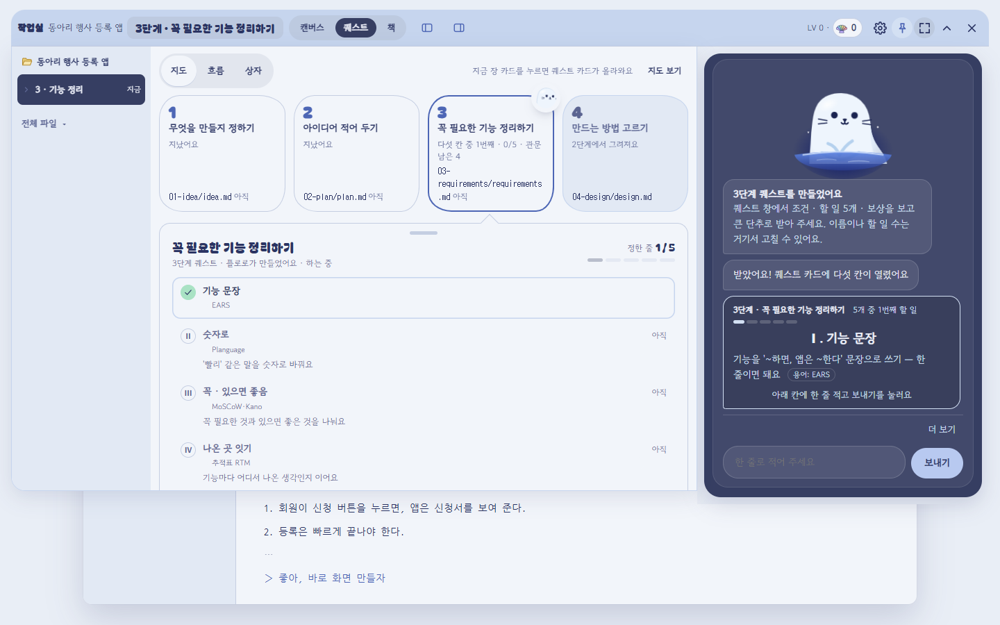
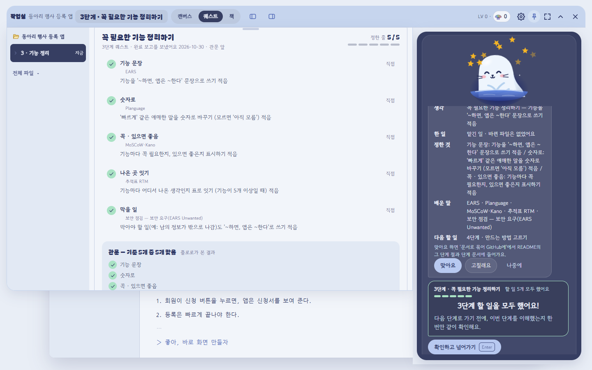
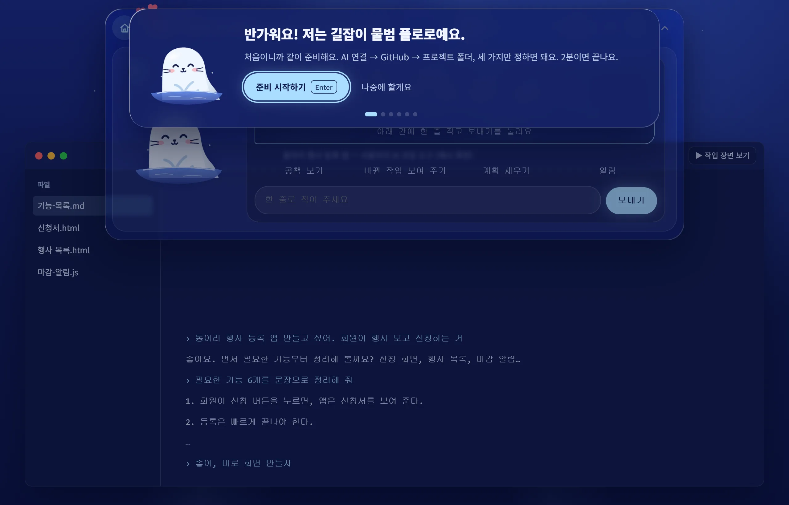
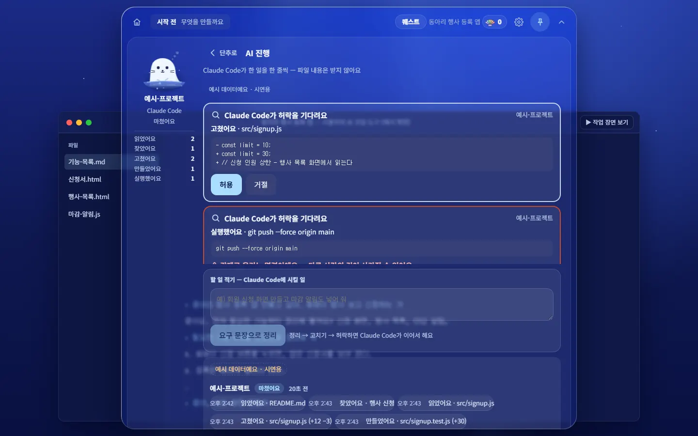
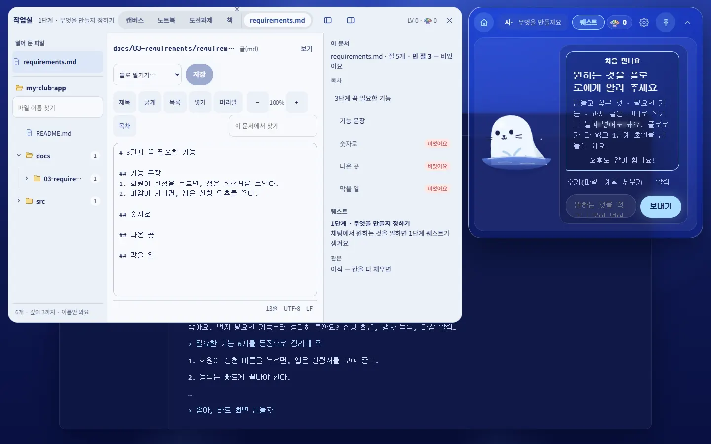
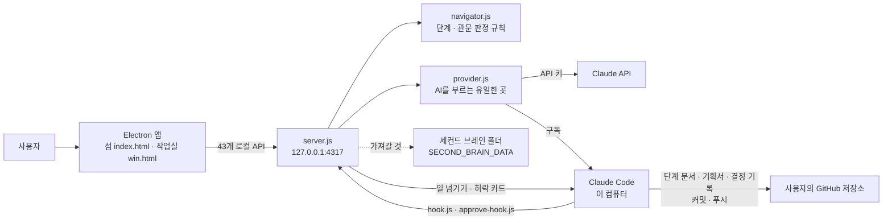

<!-- claude-drafted: 2026-10-16, 2026-10-17 갱신 — 이재엽의 요청으로 Claude가 README를 새로 썼고, 10/17에 이름 확정(이슈 #51)과 진행 상황을 반영했다. 같은 날 두승현의 요청으로 PR #91 뒤의 플로로(그림 · 표정 · 움직임)와 다시 잰 시험 개수를 반영했다.
     2026-10-19 갱신(이재엽 요청 "총합 리드미에 올려줘") — 실제로 써 보기(v2.0, PR #108)와 오버레이 앱 .dmg(v3.0, PR #111), 버전 기록 vN.M · Jira로 옮긴 할 일을 반영했다.
     2026-10-28 갱신(두승현 요청 "현재 리드미가 구식이어서 변경된 화면에 맞춰서 리드미 최신화하여 리치하게") — v37.4 · 앱 10.0.0 기준으로 다시 썼다.
     2026-11-01 갱신(두승현 요청 "ReadME 리치하게 다시 만들어줘 … my-data-assistant 이것처럼") — v60.8 · 앱 11.0.0(11/1 기능 동결 판) 기준. 참고 저장소의 차례(한 문장 → 첫 화면 → 왜 → 주요 기능 → 어떻게 동작하나 → 안전장치 → 기술 구성 → 로컬 실행 → 환경 변수 → API → 품질 → 구조 → 한계)를 따르되, 원시 HTML(div · sub · details)은 넣지 않았다(두승현 규칙). 숫자는 모두 잰 날짜와 함께 적었고, 화면 사진은 새로 찍지 않고 01-docs/features/shots/의 10/28 · 10/30 것을 썼다. -->


# 🧊 Floe — 얼음 위 작업실에서, 플로로와 함께 🦭

### AI에게 코드를 맡기는 사람이 **끝까지 만들고 · 이해하고 · 배움을 쌓도록** 곁에서 길을 안내하는 데스크톱 앱




> 켜면 바로 보이는 **작업실**입니다. 위에는 1~8단계 **지도**, 아래에는 지금 단계의 **퀘스트 다섯 칸**, 오른쪽 **섬**에서는 플로로가 한 줄씩 묻고 사람은 "맞아요 / 고칠래요"만 누릅니다.
> 2026-10-30 · 연습 예시("동아리 행사 등록 앱", 3단계) · 1440×900. 폴더를 잇기 전에는 이렇게 예시 이름이 보입니다.

| 📦 버전 기록 | 🖥 앱 | 🗓 일정 | 🏷 이름 |
|---|---|---|---|
| **v61.12** (2026-11-04) · [CHANGELOG](CHANGELOG.md) | **11.1.0** (2026-11-04, 11/1 동결 판 11.0.0 뒤 고침) · Mac · Windows · 우분투 · [Releases](https://github.com/2026-Codyssey-Final-Proj/Final-Proj/releases) | 🧪 사용 테스트 **11/4 ~ 7** · 📮 제출 **11/8 18:00** · 🎤 발표 **11/12 · 13** | **Floe**(제품) · **플로로**(마스코트) — 2026-10-17 확정 [#51](https://github.com/2026-Codyssey-Final-Proj/Final-Proj/issues/51) |

코디세이 Final-Project · 작업 이름 Project Navigator · 할 일은 Jira 프로젝트 Floe([jira.md](01-docs/00-overview/jira.md))

---

## 왜 만들었나

바이브 코딩은 결과물은 내 주지만, **지금 몇 단계인지 · 다음에 무엇을 할지 · 무엇을 정했는지**는 세션이 쌓일수록 사라진다. 코드는 늘고 문서와 이해는 비어 간다. Floe는 그 빈자리를 채우는 쪽이 **AI가 아니라 사람**이도록 만든다 — "AI가 일하는 시대에도 성장하는 건 사람이어야 한다"([시연 한 줄기](01-docs/00-overview/시연-한-줄기.md), 이재엽 확인).

| 원칙 | 제품에서의 구현 |
|---|---|
| **판정은 코드 규칙** | 지금 몇 단계인지, 관문을 넘어도 되는지는 AI가 아니라 `navigator.js`의 규칙이 정한다. AI는 초안과 설명만 낸다([ADR-0003](01-docs/03-pattern-analysis/adr/)). |
| **AI는 한 곳에서만** | 외부 AI를 부르는 파일은 `provider.js` 하나. 시험이 "다른 파일이 AI를 부르면 실패"로 지킨다. |
| **확정은 사람이 누른다** | 초안의 칸마다 "맞아요 / 고칠래요 / 직접", 관문의 "이해하셨나요?", Claude Code의 허락 요청 — 전부 사람의 단추다. 대신 허용하는 자동 길은 없다(FR-17). |
| **쉬운 말** | 화면의 말은 전문 용어를 쓰지 않는다. 용어는 작게 붙이고 "배운 말"로 모은다(FR-13 — 시험으로 강제). |
| **배움이 남는다** | 관문마다 배운 것 한 줄, 단계마다 한 장, 8단계에서 "다음 프로젝트로 가져갈 것"을 고른다. 문서는 **사용자의 GitHub 저장소**에 쌓인다. |
| **내 것으로 돈다** | 내 API 키 → 없으면 이 컴퓨터의 Claude Code 구독 → 없으면 연습 모드. 서버는 127.0.0.1에서만 열리고, 키 · 글은 저장소에 가지 않는다. |



> 3단계를 다 채운 뒤의 **관문**입니다. 왼쪽은 기준 다섯 중 다섯이 맞았다는 플로로의 확인, 오른쪽 섬은 생각 · 한 일 · 정한 것 · 배운 말 · 다음 할 일 **한 장** — 사람이 "맞아요"를 눌러야 문서가 됩니다. 2026-10-30, 연습 예시.

## 주요 기능

| | 기능 | 설명 |
|---:|---|---|
| 01 | **1~8단계 길 안내** | 정하기 → 적어 두기 → 기능 정리 → 방법 고르기 → 뼈대 → 만들기 → 재 보기 → 돌아보기. 지금 단계와 다음 할 일 한 줄을 늘 보인다. |
| 02 | **초안은 플로로, 확정은 나** | 원하는 것을 한 단락 말하면 1단계 초안이 오고, 2~8단계는 앞 단계 결과로 초안을 만든다. 4~8단계는 칸마다 예시 셋 중 고른다. |
| 03 | **퀘스트 탭 하나** | 위에 여덟 장 지도, 아래에 지금 퀘스트 다섯 칸(지금 줄만 펼침). 흐름 · 문서 상자 보기로 바꿀 수 있다. |
| 04 | **관문** | 빈칸 · 증거 없는 칸은 **안 됨**. 넘기려면 채우거나 까닭을 적고, 까닭은 결정 기록에 남는다. "이해하셨나요?"에 아니요면 헷갈린 곳 → 한 장 요약. |
| 05 | **계획 → 맡기기 → 보고** | 붙여 넣은 글로 계획을 세우고 줄마다 확정하면 **내 Claude Code**가 이어서 한다. 기준마다 해냈는지 보고가 온다. |
| 06 | **섬의 허락 카드** | Claude Code가 파일을 고치거나 명령을 돌리기 전에 허락을 구하면 섬에 카드가 뜬다. 답이 없으면 **허용되지 않은 채** 도구 자신의 확인으로 넘어간다. |
| 07 | **문서를 내 GitHub에** | 관문을 지나면 단계 문서 · 기획서 · 결정 기록 · CLAUDE.md를 작업 폴더에 쓴다. 커밋 · 푸시는 Claude Code가(허락을 받고). 비밀값 모양은 쓰기 전에 가린다. |
| 08 | **파일을 작업실에서** | 파일 칸에서 누르면 열린다 — md는 보기 좋게, 코드는 줄 번호와 git과 다른 줄. 고쳐 저장하고 되돌리며, 문서 고치기는 **틀로 맡기기**로 넘긴다. |
| 09 | **배운 것을 다음 프로젝트로** | 관문마다 배운 것 한 줄, 단계마다 한 장, 8단계에서 가져갈 것을 골라 다음 프로젝트의 그 단계에서 다시 본다. 지식 창고(세컨드 브레인)로도 넣는다. |
| 10 | **플로로** | 표정 11가지 · 고개 돌리기 · 둥실 · 잠수 · 쓰다듬기. 뽑기로 받은 장식을 머리에 쓰고 같이 움직인다. 섬을 접으면 가장자리의 알약 안에서 얼굴만 내민다. 움직임 줄이기 설정을 켠 사람에게는 움직이지 않는다. |

기능마다 무엇 · 왜 · 흐름 그림 · 시연 GIF → [기능 지도](01-docs/features/README.md). 있는 기능 **81개**를 하나도 빠짐없이 적은 표 → [기능 전체 목록](01-docs/features/2026-10-31-기능-전체-목록.md) · [우선순위](01-docs/features/2026-10-31-기능-우선순위.md) · [마감 전 줄이기 제안](01-docs/features/2026-10-31-기능-줄이기-제안.md)

### 화면 더 보기

| 처음 설정 — 플로로가 반기고 같이 준비 | 섬의 허락 카드 — 고친 줄을 보고 허용 · 거절 |
|---|---|
|  |  |
| AI 연결 → 같이 쓸 앱 → GitHub → 프로젝트 폴더를 하나씩. 키는 앱에만 두고 화면은 저장하지 않는다. | `git push --force` 같은 되돌리기 어려운 일은 빨간 테두리로 한 번 더 묻는다. (10/28 사진 — 섬의 겉모양은 그 뒤 바뀌었고 카드는 같다) |



> **파일 보기 · 고치기**(10/28 사진 — 탭 이름은 그 뒤 '퀘스트' 하나로 합쳐졌다). 오른쪽 칸이 이 문서의 빈 절을 짚어 주고, 머리의 "틀로 맡기기"가 "이 문서를 이렇게 고쳐 줘"를 Claude Code에 넘긴다.

---

## 어떻게 동작하나



- **앱 하나에 셋이 들어 있다.** 섬(플로로와 채팅) · 작업실(지도 · 퀘스트 · 책 · 파일) · 로컬 서버. 서버는 앱이 켤 때 같이 켜지고 `127.0.0.1`에서만 듣는다.
- **Claude Code는 사용자의 프로젝트 폴더에서 돈다.** Floe가 그 폴더의 `.claude/settings.local.json`에 훅 둘을 더해, Claude Code가 한 일(읽음 · 고침 · 실행)과 허락 요청이 섬으로 온다. 끝나면 `--off`로 뺀다.
- **판정은 코드, 초안은 AI, 단추는 사람.** 단계 번호 · 관문 통과는 `navigator.js`의 규칙이고, AI는 초안 · 설명 · 계획만 낸다. 사람이 누르기 전에는 아무것도 적히지 않는다.

### AI가 참고하는 정보

| 블록 | 출처 | 언제 | 역할 |
|---|---|---|---|
| 넣은 글 | 섬에 적은 한 줄 · 붙여 넣은 글 | 매 요청 | "무엇을 만들고 싶은가"의 원문 |
| 지난 단계 결과 | 그 단계에서 확정한 칸 | 단계 초안 · 관문 때 | 2~8단계 초안의 바탕 |
| 작업 폴더의 단계 문서 · 결정 기록 | `docs/**` (사용자 저장소) | '같이 읽기'를 켰을 때만 | 계획의 근거, 가져갈 것의 초안 |
| 가져온 것 | 지난 프로젝트에서 채택한 배운 것(단계마다 3개) | 그 단계에 들어설 때 | "지난번엔 이랬다"를 초안에 |

모아서 `sensitive.js`로 비밀값 · 메일 · 전화 모양을 가린 뒤 **4,000자까지**만, 자료로만 보낸다(그 안의 지시는 따르지 않는다). 파일 내용 · 먹이 주기가 뺀 구간은 받지도 않는다. 무엇이 나가는지는 [security-records.md 3절](.claude/rules/security-records.md)에 경로마다 적혀 있다.

### 운영 안전장치

- 서버는 `127.0.0.1`에서만 열리고, 요청마다 **출처와 확인 값**(화면은 쿠키, 훅은 머리글)을 본다. 맞지 않으면 403.
- **허락은 사람만.** 허락 훅은 섬의 답을 기다리고(서버 기본 90초), 답이 없거나 서버가 꺼져 있으면 **허용되지 않은 채** Claude Code 자신의 확인으로 넘긴다. 결정은 그 요청의 지문과 짝이 맞을 때만 받는다.
- **토큰 장부.** 어느 AI로 얼마나 썼는지 `GET /api/usage`로 보이고, 한도를 넘으면 멈춘다. 호출 기록은 녹화해 두고 `NAV_REPLAY`로 **실제 AI 없이** 재생한다 — 시험 전부가 이 길로 돈다.
- **연습 모드가 늘 뒤에 있다.** 키가 거절되거나 서버가 없으면 '연습용 예시로 둘러보기'로 바로 간다. 시연 · 사용 테스트는 이 판으로도 끝까지 된다.
- **밖으로 나가는 요청은 AI 호출뿐.** 글꼴 · 그림은 앱 안에 있다(문서 지도 엔진의 Google Fonts `@import`도 뺐다). Claude Desktop 같이 쓰기 · 원격 MCP는 **기본 꺼짐**(시험판).
- **문서를 올리기 전에** 저장소가 공개인지 `gh`로 묻고, 공개(또는 모름)면 저장소마다 처음 한 번 더 묻는다. 글은 쓰기 전에 가린다.

---

## 기술 구성

| 영역 | 선택 | 이유 |
|---|---|---|
| 앱 | Electron 44.9.0 · electron-builder | 섬 · 작업실 · 서버를 한 설치 파일로. Mac `.dmg` · Windows `.exe` · 우분투 `.AppImage` / `.deb` |
| 화면 | Vanilla JavaScript · CSS | 프레임워크 없이 서버 없이도 `index.html` 하나로 열린다. 섬은 19개 조각을 `app-parts.js`로 묶어 `app.js` 하나 |
| 서버 | Node.js 내장 `http` | 이 컴퓨터 안에서만 듣는 로컬 API 43개. 의존성은 Anthropic SDK 하나 |
| 판정 | 코드 규칙(`navigator.js`) | 단계 · 관문 · 칸 상태를 AI 바깥에 둬 **같은 입력이면 같은 답** |
| AI | Claude — API 키 또는 이 컴퓨터의 Claude Code | 각자 자기 키 · 구독으로. 호출은 `provider.js` 한 곳, 녹화 · 재생으로 시험 |
| 코딩 도구 연동 | Claude Code 훅(`hook.js` · `approve-hook.js`) + `claude -p` | 사용자의 폴더에서 도는 Claude Code를 바꾸지 않고 곁에서 듣고 묻는다 |
| 문서 지도 | archi-board 엔진 v1 사본(ArchiMate 표기, MIT) | 문서가 어떻게 이어지는지 상자와 선으로. 엔진은 원 저장소에서만 고친다 |
| 시험 | node `--test` · python · Puppeteer e2e | 실제 AI · 실제 GitHub 없이 돈다. 커밋 전 훅이 전체 시험을 요구한다 |
| CI | GitHub Actions 4개 | `app-parts`(조각 ↔ app.js 일치) · `pr-base`(base는 main) · `jira-release`(변경 조각 → CHANGELOG · Jira 릴리스) · `app-release`(앱 버전이 오르면 세 OS 빌드) |

---

## 로컬 실행

### 1) 앱으로 — 가장 쉬운 길

[Releases](https://github.com/2026-Codyssey-Final-Proj/Final-Proj/releases)에서 내려받는다.

| 컴퓨터 | 받을 파일 | 여는 법 |
|---|---|---|
| 🍎 Mac | `.dmg` | 우클릭 → 열기 (서명 없음) |
| 🪟 Windows | `.exe` | 설치 뒤 실행 |
| 🐧 우분투 | `.AppImage` 또는 `.deb` | 실행 권한 주고 더블클릭 |

처음 설정에서 AI 연결과 프로젝트 폴더를 고르면 작업실의 플로로 홈이 열린다. **그 폴더에서 Claude Code를 새로 연다.** 자세히 → [팀 작업 가이드 2-c](01-docs/00-overview/team-guide.md)

### 2) 코드로

```bash
git clone https://github.com/2026-Codyssey-Final-Proj/Final-Proj.git
cd Final-Proj

node 03-backend/navigator/server.js               # 🦭 화면 + 서버 → http://127.0.0.1:4317
node 03-backend/navigator/floe.js ~/내-프로젝트    # 🧊 내 프로젝트에 붙여 써 보기 (훅 연결 → 서버 → 브라우저). 끝나면 --off
python 04-tests/run_all_tests.py                  # 🧪 전체 시험 (실제 AI 없이)

cd 02-frontend/electron
npm install && npm start                          # 🖥 앱으로 켜기 — 저장소의 화면 · 서버 코드를 바로 읽는다
npm run dist                                      # 📦 앱 묶기 (Windows: dist:win · 우분투: dist:linux)
```

**서버 없이** — `02-frontend/index.html`을 브라우저로 열면 연습 예시로 섬을 볼 수 있다(작업실 창은 앱에서만).

### 환경 변수

키 · 확인 값은 **저장소에 없다.** 각자 컴퓨터의 환경(또는 서버 옆 `.env`)에만 둔다. 아무것도 없으면 이 컴퓨터의 Claude Code 구독 → 그것도 없으면 연습 모드.

| 변수 | 필수 | 설명 |
|---|:---:|---|
| `ANTHROPIC_API_KEY` | 아니오 | 있으면 **내 키**로 Claude API를 부른다(한도 · 사용량도 내 것). 없으면 Claude Code 구독(`claude -p`) |
| `ANTHROPIC_BASE_URL` | 아니오 | 중계 서버의 가상 키를 쓸 때 그 주소 — '호환 모드'로 표시된다 |
| `NAV_PORT` | 아니오 | 서버 포트, 기본 `4317`. 훅은 값이 없으면 서버가 남긴 파일에서 읽는다 |
| `NAV_REPLAY` | 아니오 | 녹화한 AI 응답을 재생 — 시험 · 시연에서 실제 호출 없이 |
| `NAV_APPROVAL_WAIT` | 아니오 | 허락 카드의 답을 기다리는 시간(ms), 서버 기본 `90000` |
| `NAV_MCP` | 아니오 | `1`이면 원격 MCP(웹 Claude · 웹 GPT, 터널)도 받는다. **기본 꺼짐**, 시험판 |
| `NAV_CLAUDE_BIN` | 아니오 | `claude` 명령의 경로를 직접 줄 때 |
| `SECOND_BRAIN_DATA` | 아니오 | 세컨드 브레인 데이터 폴더 — 있을 때만 '지식 창고로' 넣기가 켜진다 |

---

## API 한눈에

로컬 API **43개**(2026-10-31 [API.md 1절](03-backend/navigator/API.md) 기준) 중 흐름의 뼈대만. 전부 `127.0.0.1`, 출처 · 확인 값 검사, 시험 `api-contract.test.js`가 그대로 대조한다.

| Method | Endpoint | 설명 |
|---|---|---|
| `GET` | `/api/setup` · `POST /api/setup/check` | 이 컴퓨터가 AI를 어떻게 부를 수 있나 · 연결 확인 (키 값은 오가지 않는다) |
| `POST` | `/api/start` · `/api/stagedraft` | 처음 말한 글로 1단계 초안 · 앞 단계 결과로 2~8단계 초안 |
| `POST` | `/api/chat` | 플로로와 자유 대화 — 답 + 이 대화로 채울 수 있는 칸 (적지는 않는다) |
| `POST` | `/api/judge` · `/api/review` | 지금 단계에서 어디쯤인지 · 고친 칸 다시 보기 (판정은 코드 규칙) |
| `POST` | `/api/plan` · `/api/task/tidy` · `/api/task/start` | 계획 세우기 · 요구 문장으로 정리 · 확정한 줄을 Claude Code에 맡기기 |
| `POST` | `/api/approval` → `GET /api/approvals` → `POST /api/approvals/decide` | 허락 훅이 카드를 보내고 **답을 기다림** → 섬이 보고 → 허용 · 거절 |
| `POST` | `/api/event` · `GET /api/events` · `GET /api/steps` | 훅의 알림 → 섬이 2초마다 받아 "읽음 · 고침 · 실행" 줄로 |
| `POST` | `/api/docs` · `GET /api/docs` | 단계 문서 · 기획서 · 결정 기록을 작업 폴더에 쓰기 · 다시 읽기 |
| `GET` | `/api/files` · `/api/file?i=N` · `POST /api/file` · `POST /api/preset` | 파일 칸 · 파일 보기 · 저장(바뀌었으면 묻고) · 틀로 맡기기 |
| `GET` | `/api/docmap?now=…` | 문서가 이어진 모습을 보드 데이터로 |
| `POST` | `/api/carry/draft` · `GET /api/carry` · `POST /api/carry` | 가져갈 것 초안 · 장부 · 채택 · 반려 |
| `GET` | `/api/usage` | 어느 AI로, 얼마나 썼나 |
| `POST` | `/mcp/<토큰>` | Claude Desktop(이 컴퓨터) · 원격(`NAV_MCP=1`일 때만) — 읽기 · 제안만, 시험판 |

---

## 품질 확인

🧪 **2026-11-04** `python 04-tests/run_all_tests.py`(Windows 11, Node v24.18.1 · Python 3.14.6)로 잰 값 — 노드 시험 **1,207개 중 1,113 통과 · 실패 0** · 94개는 건너뜀(대부분 브라우저 도구 `PUPPETEER_PATH`가 없어서), 노드 시험 파일 145 · 파이썬 시험 파일 23/23 통과. 시간을 재는 `hook-steps`의 600ms 시험은 컴퓨터가 바쁠 때 가끔 실패한다(같은 날 두 번, 그 파일만 다시 돌리면 통과).

| 무엇 | 어떻게 |
|---|---|
| 규칙 · 서버 · 화면 조각 | node `--test` — 시험 파일 navigator 104 · library 7 · acceptance 2 (2026-11-04 센 값). 실제 AI · 실제 GitHub 없이 녹화 재생으로 |
| 실제 브라우저로 누르기 | e2e 27 파일 — `PUPPETEER_PATH`에 Chrome을 주면 돈다. 없으면 건너뛴다 |
| 저장소 규칙 | python 7 + 훅 시험 7 — 변경 조각 네 줄, CHANGELOG 겹침, 링크, Mermaid, 비밀값 |
| 커밋 전 | 훅 12개([CLAUDE.md "훅"](CLAUDE.md)) — 시험 실패 · 비밀값 · `main` 직접 커밋 · `--force`를 기계적으로 막는다 |
| 알려진 실패 | [known-failures.json](04-tests/known-failures.json)에 고칠 목록 번호 · 기한(14일 안)과 함께. 기한까지 보이되 막지 않는다 |

---

## 프로젝트 구조

```text
Final-Proj/
├─ 02-frontend/
│  ├─ index.html · navigator/app/*.js    # 🦭 섬 — 조각 19개 → app.js (node navigator/app-parts.js join)
│  ├─ navigator/win.html · win.js        # 🗂 작업실 창
│  ├─ assets/mascot/                     # 플로로 그림 · 표정 (두승현)
│  └─ electron/                          # 🖥 앱 껍데기 — main.js · package.json(앱 버전) · release-notes.md
├─ 03-backend/navigator/
│  ├─ server.js                          # 로컬 API 43개 (127.0.0.1:4317)
│  ├─ navigator.js                       # 단계 · 관문 판정 규칙 (AI 아님)
│  ├─ provider.js                        # 외부 AI를 부르는 유일한 곳
│  ├─ hook.js · approve-hook.js          # Claude Code 훅 — 알림 · 허락
│  ├─ floe.js · connect.js               # 내 프로젝트에 붙이기 · 떼기
│  ├─ board/                             # 문서 지도 엔진 (archi-board 사본)
│  └─ API.md                             # 로컬 API 약속
├─ 04-tests/                             # run_all_tests.py · navigator/ · e2e/ · repo/ · known-failures.json
├─ 01-docs/
│  ├─ 00-overview/                       # 요구사항 · 일정 · 결정 모음 · 시연 한 줄기
│  ├─ features/                          # 기능별 README + GIF · 기능 전체 목록 · 우선순위 · 줄이기 제안 · shots/
│  ├─ 04-pattern-implementation/         # 0~8단계 스토리보드 · 디자인 기준
│  └─ 07-maintenance/fix-map.md          # 고칠 곳 지도 (F-번호)
├─ changes/                              # PR마다 변경 조각 한 장 → 병합되면 CHANGELOG로
├─ .claude/                              # 규칙 · 훅 · 스킬 — Claude가 읽는 설정
├─ 05-projects/second-brain/             # 지식 창고 (가져갈 것이 들어가는 곳)
├─ CHANGELOG.md · TEAM.md · CLAUDE.md
```

코드 크기(2026-10-31 잼): 섬 조각 4,646줄 · 서버 54 파일 6,414줄 · 문서 지도 엔진 1,270줄 · 숨긴 서재 1,554줄.

---

## 지금 어디까지 — 시연 장면 다섯 (2026-11-01)

11/1 기능 동결. 이제부터 제출까지는 **장면 다섯**만 본다([시연 한 줄기](01-docs/00-overview/시연-한-줄기.md)). 색은 연습 판으로 끝까지 되는지 · 시험 · 진짜 AI 기록으로 칠했다.

| # | 장면 | 색 | 남은 일 |
|---|---|---|---|
| 0 | 켜기 — 처음 설정 | 🟡 | '같이 쓸 앱' 칸을 숨길지(결정 대기) |
| 1 | 켜면 작업실 → 1단계 초안 | 🟡 | 진짜 AI로 다시 재기, e2e 하나 |
| 2 | 퀘스트 탭 | 🟡 | 상자 보기 숨길지 |
| 3 | 관문 — 이해했나요 → 배운 것 → 한 장 | 🟡 | 진짜 AI로 다시 재기 |
| 4 | 맡기기 — 계획 → Claude Code → **허락 카드** → 보고 | 🔴 | 진짜 AI 기록에서 허락 카드 없이 커밋된 것(#294) — 까닭 찾는 중 |
| 5 | 기록 — 문서가 내 GitHub에 · 책 탭 | 🟡 | 올리기 거절(409) 때 알리기 · 저절로 부르는 호출 끄기 |

🟢 연습 판에서 끝까지 되고 시험도 초록 · 🟡 되지만 남은 일 있음 · 🔴 시연 메시지와 어긋나거나 막힘. **11/2 리허설 목표: 빨강 0.**

게이트 · 고칠 목록 → [게이트 로그](01-docs/01-problem-save/sessions/project-track/2026-10-18-floe.md) · [고칠 곳 지도](01-docs/07-maintenance/fix-map.md) · 일정 → [schedule.md](01-docs/00-overview/schedule.md)

---

## 알려진 한계

- **PC용이다.** 섬은 600px 아래에서 한 줄 규칙만 있고, 휴대폰 화면은 맞추지 않았다.
- **AI는 Claude만.** API 키 또는 Claude Code 구독. 다른 AI는 '다른 AI에 넘기기'(복사할 글)로만.
- **앱 서명이 없다.** Mac은 우클릭 → 열기, Windows는 SmartScreen 경고를 지나야 한다(F-41).
- **진짜 AI로 한 바퀴는 아직 노랑 · 빨강.** 연습 판은 끝까지 되지만, 10/30 진짜 AI 기록에서 허락 카드가 안 뜬 채 커밋된 일(#294)이 남아 있다. 위 장면 4.
- **Claude Desktop 같이 쓰기 · 원격 MCP는 시험판.** 도구 넷이 보이는 것까지 확인, 대화로 한 바퀴는 아직. 기본 꺼짐.
- **e2e는 이 컴퓨터에서 안 돌았다.** 위 "품질 확인"의 건너뛴 94개가 그것이다 — Chrome 경로를 주면 돈다.
- 숨겨 둔 것: 서재(1,554줄) · 지식 은하 · 먹이 주기의 시연 노출. 대회 뒤 지울 코드는 약 3,300줄([줄이기 제안 5절](01-docs/features/2026-10-31-기능-줄이기-제안.md)).

---

## 🦭 플로로를 소개합니다


물에서 고개를 내민 **길잡이 물범**. 지금 단계를 알려 주고, 기다리는 동안 곁을 지켜요. 표정 11가지, 눈 · 코가 마우스 쪽으로, 둥실 · 빼꼼 · 잠수 · 물 뿜기, 쓰다듬으면 하트. 🎨 화면 속 플로로 두승현 · 원본 그림 이재엽(두승현이 제안한 스킬로) · 자세히 → [마스코트 README](02-frontend/assets/mascot/README.md)

---

## 👥 팀

| | 이름 | 맡은 일 |
|---|---|---|
| 🧑‍✈️ | 이재엽 | 팀장 · 총괄 · 제출 · AI 에이전트 · API 연동 |
| 🎨 | 고한결 | UI/UX · 인터뷰 · 발표 흐름 |
| 🖥 | 임유정 | 프론트엔드 · 시연 화면 |
| 🧪 | 두승현 | 시연 프로토타입 · 화면 속 플로로 · 테스트 · 검증 · 문서 · 협업 증빙 |

🤖 Claude는 브랜치에만 올리고 병합은 사람이. 올릴 때는 [`changes/`](changes/README.md) 조각 한 장 → 병합되면 버전 번호가 붙는다. 상세 → [TEAM.md](TEAM.md) · 라이선스 [MIT](LICENSE)

## 🔗 더 읽기

📋 [요구사항](01-docs/00-overview/requirements.md) · 🎬 [시연 한 줄기](01-docs/00-overview/시연-한-줄기.md) · 🗓 [일정](01-docs/00-overview/schedule.md) · 🎯 [우선순위](01-docs/00-overview/team-priorities.md) · 📐 [0~8단계 스토리보드](01-docs/04-pattern-implementation/stage-storyboard/README.md) · 🏛 [ADR](01-docs/03-pattern-analysis/adr/) · 🔒 [공유 · 보안](01-docs/00-overview/team-sharing-security.md) · 📦 [버전 기록](CHANGELOG.md) · 🛠 [고칠 곳 지도](01-docs/07-maintenance/fix-map.md) · 🧭 [시작하기](GETTING_STARTED.md)
