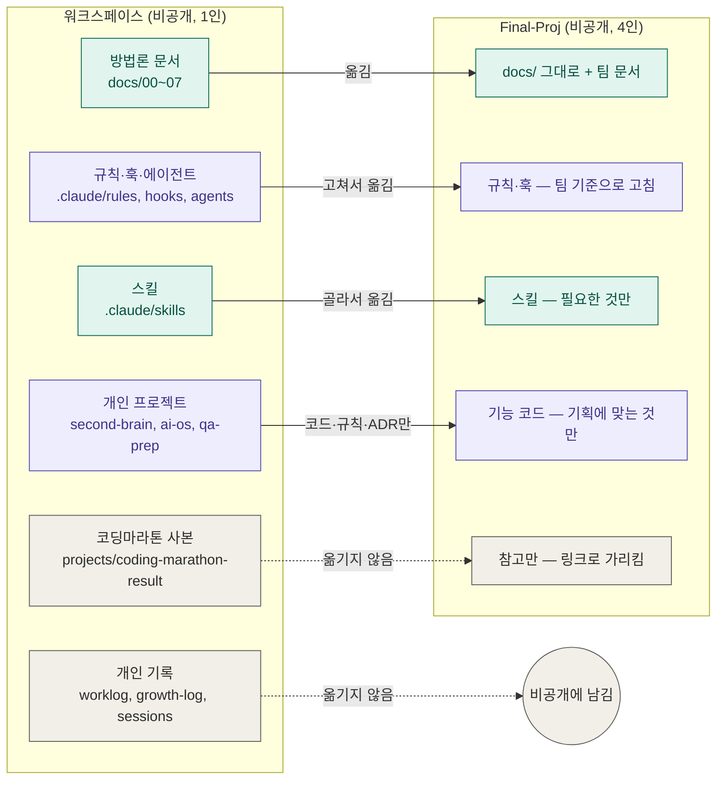
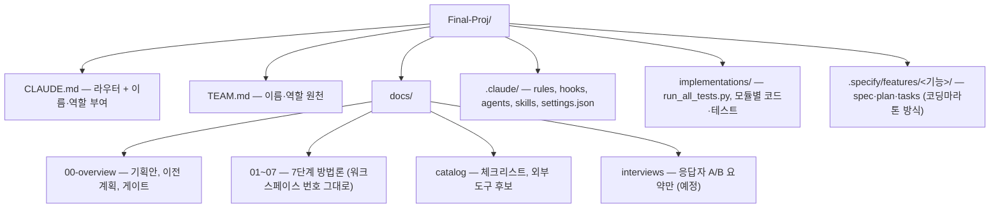
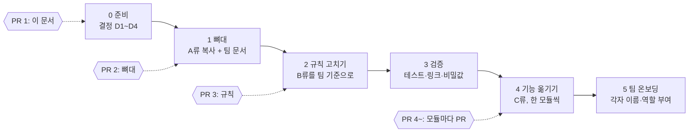

<!-- claude-drafted: 2026-10-12 — 이재엽의 요청("전체적으로 final-proj으로 옮기고, 워크스페이스와 맞는지 확인하고, 다이어그램과 함께 준비")으로 Claude가 워크스페이스(`gamercross/workspace`, 비공개)를 읽고 썼다. 분류와 결정은 이재엽이 확정한다. 상태: 계획 — 아직 아무것도 복사하지 않았다. -->

# 워크스페이스 → Final-Proj 이전 계획

**한 줄 요약:** 워크스페이스는 *혼자 쓰는 비공개 작업 공간*이고 Final-Proj는 *4명이 쓰는 레포*다(2026-10-12 비공개로 전환, 협업자 전원이 읽는다). 그래서 통째로 복사하지 않고
**방법(메커니즘)은 옮기되 개인 기록은 두고, 한 사람 기준인 규칙은 팀 기준으로 고쳐서** 옮긴다.

## 1. 무엇을 옮기고 무엇을 두는가

| 구분 | 무엇 | 왜 |
|---|---|---|
| **A. 그대로 옮김** | `docs/02~07` 방법론 문서, `docs/catalog/`의 빈 구조, 템플릿(`prd-template.md` 등), 훅 중 일반적인 것(`block-dangerous-git`, `check-secrets`, `check-links`, `check-mermaid`, `check-skills`), `implementations/run_all_tests.py`, 외부 스킬 6개(Apache 2.0·MIT, 출처 표 포함) | 사람·프로젝트에 묶이지 않은 방법이다 |
| **B. 고쳐서 옮김** | `CLAUDE.md`(라우터), `review-mode.md`, `git-workflow.md`, `security-records.md`, `consistency.md`, `reference-intake.md`, `unreviewed-commits.sh`, `pre-commit.sample`, `dev-workflow` 스킬 | "사용자 한 명" 기준이거나 개인 이름·결정·`data` 브랜치·`template` 원격이 들어 있다 — 아래 3절 |
| **C. 기능만 옮김** | `second-brain` 코드·테스트·ADR(개인 데이터 `data/` 제외), 기획의 ③ 성장 기록·장기 기억에 닿는 부분 | 기획에 맞는 것만. 어디까지는 결정 D1 |
| **D. 옮기지 않음** | `worklog.md`, `growth-log.md`, `sessions/` 안의 세션 파일, `second-brain/data`, `ai-os`(생활·메일·계정), `qa-prep-system` 결과물, `projects/coding-marathon-result/source` | 이재엽 개인 기록이거나, **다른 사람의 작업 사본**이거나, 공개하면 안 되는 것(계정·2단계 인증 상태, 학교 자료) |

> `security-records.md`에는 계정 보안 상태 같은 개인 사실이 적혀 있어 **원본을 그대로 올리지 않는다.** 팀용으로 "원칙"만 새로 쓴다.

## 2. 도착한 모양

번호는 워크스페이스의 `docs/00~07`을 **그대로** 쓴다. 이전 초안의 `docs/10-design`은 쓰지 않고, UI/UX 설계는 4단계(`docs/04-pattern-implementation/`) 아래에 둔다 — 같은 번호 체계를 쓰면 훅·링크 규칙을 고치지 않아도 된다.

## 3. 워크스페이스 규칙과 맞는지 — 어긋나는 곳

| 워크스페이스 규칙 | 팀 레포에서의 문제 | 고치는 방향 |
|---|---|---|
| 작업물은 **사용자가 쓰고 Claude는 리뷰**한다 (`review-mode.md`) | "사용자"가 한 명이 아니다. 역할마다 작성자가 다르다 | "사용자" → **작성자(담당자)**. 담당은 `TEAM.md`가 정한다. 힌트→예시 수위와 `claude-drafted` 표시는 그대로 |
| 성장 로그 `growth-log.md`는 한 사람의 판정 차이를 쌓는다 | 개인 기록이라 4명이 읽는 레포에 맞지 않고 4명을 섞으면 의미가 없다 | 개인별 **로컬 파일**로 두거나(커밋 안 함) 팀 회고 한 장으로 바꾼다. 결정 D3 |
| **병합은 사용자가 한다** (`git-workflow.md`) | PR 병합 절차 자체가 팀 결정과 다르다 | 팀 결정(D4): 모두 `main`에 직접 커밋. `git-workflow.md`의 "병합은 사용자가 한다"와 `block-merged-branch-push.sh`는 팀용으로 고치거나 뺀다 |
| `data` 브랜치·`template` 원격·noreply 이메일(`gamercross`) | 팀원은 다른 계정이고 `data` 브랜치는 개인 데이터용 | 해당 문장을 지운다. 이메일은 각자 noreply |
| `unreviewed-commits.sh`가 `Co-Authored-By`와 `growth-log`의 `last-reviewed:`를 읽는다 | 개인 로그에 의존 | 훅을 팀용으로 단순화(PR 리뷰 여부)하거나 뺀다 |
| `check-secrets.sh`·`pre-commit.sample`의 개인 경로 가정 | 새 클론에서는 경로가 다르다 | 경로·주석에서 개인 이름 제거, 테스트(`test_check_secrets.py`)와 함께 옮긴다 |
| 라우팅 표가 `projects/<슬러그>/`를 전제 | 이 레포는 제품 하나 | `projects/` 층을 없애고 `.specify/features/`와 `implementations/`로 |
| 협업자 전원이 읽는 레포인데 `security-records.md` 3절에 외부 서비스·계정 사실 | 노출 위험(나중에 공개로 바꾸면 이력째 보인다) | 위 상자대로 팀용으로 새로 작성 |
| `consistency.md`의 기준 파일 지도가 `projects/*`, `growth-log`를 가리킴 | 지도가 낡는다 | 이전하며 지도의 행을 같이 고친다 |

**잘 맞는 곳:** 7단계·게이트(DoR/DoD), EARS·Planguage, TDD, 비밀값 훅, 링크·Mermaid 검사 — 개인 정보가 없고 팀에서도 같은 말이다. 코딩마라톤 방식(의도명세 → EARS)은 이미 2단계 문서에 들어 있다.

## 4. 어떻게 진행하나

| 단계 | 하는 일 | 끝 조건 | PR |
|---|---|---|---|
| 0 준비 | 아래 결정 D1~D4를 이재엽이 정한다 | 결정이 이 문서에 적혔다 | 이 PR |
| 1 뼈대 | A류 복사, `TEAM.md`·`CLAUDE.md`·기획안 | `run_all_tests.py` 통과, 링크 0건 깨짐 | PR 2 |
| 2 규칙 | B류를 3절 표대로 수정 (한 파일씩 diff 확인) | 개인 이름·원격·계정 문자열 0건(grep) | PR 3 |
| 3 검증 | 새 클론에서 훅 4종이 도는지, 비밀값 검사가 막는지 | 훅 시험 통과 | PR 3에 포함 |
| 4 기능 | 모듈 하나씩 TDD 테스트와 함께 | 모듈마다 테스트 통과 | PR 4~ |
| 5 온보딩 | 팀원이 각자 `CLAUDE.md` 절차로 이름·역할 확인 | 3명 모두 `identity.local.md` 생성 | — |

**각 단계의 안전장치:** 푸시 전에 `grep -rnE 'gamercross|jaeyeup|@gmail|\.local|192\.168|mis\.|sumzip'`로 개인·인프라 문자열이 0건인지 본다. 비공개여도 협업자는 전원이 읽고, 한 번 올라가면 이력에 남는다.

## 5. 이재엽이 정할 것

| ID | 질문 | 추천 |
|---|---|---|
| D1 | 세컨드 브레인의 **어디까지** 가져오나? 코드+ADR 전부 / 성장 기록·장기 기억에 닿는 모듈만 / 방법만(코드 없음) | 모듈만 — 기획의 ③에 닿는 부분, 나머지는 개인 프로젝트로 남긴다 |
| D2 | 다른 팀원도 같은 규칙으로 일하나? (7단계·게이트·리뷰 모드를 팀 전체 필수로) / 총괄만 쓰고 나머지는 자유 | 규칙은 두되 **필수는 훅이 기계로 막는 것만** (비밀값·위험한 git·링크). 나머지는 권장 |
| D3 | 성장 로그를 어떻게 하나? 개인 로컬 / 팀 회고 한 장 / 두지 않음 | 개인 로컬(커밋 안 함) + 팀 회고는 7단계에서 한 장 |
| D4 ✔ | 커밋 권한 | **정함(이재엽 2026-10-12): 팀원 모두 `main`에 직접 커밋·푸시.** 규칙은 [CLAUDE.md](../../CLAUDE.md) "브랜치·커밋". 안전장치는 훅(비밀값·`--force`)과 푸시 전 `pull --rebase` |

## 6. 아직 모르는 것 (확인 전에는 쓰지 않는다)

- 팀원 3명의 GitHub 계정과 이름의 연결 — 이재엽이 알려 준다.
- 기술 스택(프론트·백엔드·배포). 계획 단계(`plan.md`)에서 팀이 정한다. 코딩마라톤은 Vue·Express·MariaDB였지만 **이 팀의 결정이 아니다**.
- 코딩마라톤 결과를 어떻게 인용해도 되는지(팀 과제라 다른 두 명의 몫이 섞여 있다). 이 레포에는 원문을 복사하지 않고 **방식만** 적었다.
