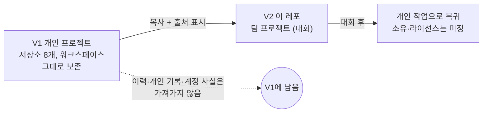

<!-- claude-drafted: 2026-10-12 — 이재엽의 요청("겹치는 문서는 병합")으로 Claude가 migration-plan · team-workplan · v2-references-and-code 세 문서를 합치고, 실제로 이전한 결과로 다시 썼다. 판단은 이재엽이 확정한다. -->

# V1 → V2 이전 기록

개인 프로젝트(V1, 이재엽의 워크스페이스)가 팀 프로젝트(V2, 이 레포)로 승격되면서 **무엇을 옮겼고, 무엇을 옮기지 않았고, 왜 그랬는지**를 한 곳에 적는다.
이전 계획 문서 세 개(`migration-plan`, `team-workplan`, `v2-references-and-code`)를 이 문서로 합쳤다.

## 0. V1 · V2 · 그 뒤

- V1은 **고치거나 지우지 않는다.** 이력·PR·브랜치는 그대로다. V1 시점을 표시하려면 이재엽이 워크스페이스에 태그(예: `v1-personal`)를 단다 — 푸시가 필요해 Claude가 하지 않는다.
- V2에서 V1을 인용할 때는 "출처: V1, `my-workspace` 커밋 `<해시>`" 한 줄이면 된다.
- 대회 후 개인 작업의 **소유·라이선스는 미정**이다. 팀원 기여의 사용 범위와 대회 규정을 확인하고 팀원과 글로 합의해야 한다 — 법적 판단은 Claude가 하지 않는다.

## 1. 옮긴 것

| 구분 | 위치 | 비고 |
|---|---|---|
| 방법론 문서 | `docs/00~07`, `docs/catalog/` | 7단계 방법론, 게이트(DoR/DoD), 등급(Full/Xpress/Lite), 체크리스트, 후보 장부 |
| 규칙 | `.claude/rules/` 10개 | `git-workflow`·`security-records`는 **팀용으로 다시 썼다**(아래), `review-mode`는 팀 적용 안내를 머리에 추가 |
| 훅 | `.claude/hooks/` 9개 + `block-claude-main.sh` | 비밀값·위험 git·링크·Mermaid·병합된 브랜치 푸시 차단 |
| 스킬 | `.claude/skills/` | `dev-workflow`, `qa-prep`, `reference-library`와 외부 스킬 6개(출처·라이선스 `VENDORED.md`) |
| 에이전트 · MCP | `.claude/agents/verify.md`, `.mcp.json` | draw.io MCP |
| 테스트 도구 | `implementations/run_all_tests.py`, `implementations/hooks/` | |
| 세컨드 브레인 | `projects/second-brain/` | 코드·테스트, ADR 0003~0007, 레프런스 분석 15개, `PROGRESS.md` |

## 2. 옮기지 않은 것

| 무엇 | 왜 |
|---|---|
| 작업 로그 `worklog.md`, 성장 로그 `growth-log.md`의 **기록** | 한 사람의 개인 기록. 규칙·표 틀만 옮기고 비웠다 |
| 세컨드 브레인 **세션 파일**(1088줄) | 사용자 발언 원문 표와 개인 계정 보안 설정이 섞여 있다. 게이트 로그와 설정값 표만 `PROGRESS.md`로 옮겼다 |
| `data` 브랜치(할 일 문서·실행 기록·목록) | 개인 데이터. 이 레포에 두지 않는다 |
| `projects/ai-os/` | 생활·메일·계정 이야기 |
| `projects/qa-prep-system/` 프로젝트 문서 | 발표 준비 프로젝트(10/18 발표 후 재개). `qa-prep` **스킬**은 옮겼다 |
| `projects/coding-marathon-result/` | 팀 3인의 공동 작업이라 다른 두 명의 동의 전에는 복사하지 않는다 — 방식만 인용 |
| 코딩마라톤 가이드 스크린샷·PDF 원본(119개, 158MB) | 도메인이 안 가려진 원본, 복제 금지 표시 PDF 2개. 이재엽의 로컬 폴더에만 있다 |
| 계정 보안 설정, 개인 알림 서비스 연동 | 한 사람의 보안 상태를 전원이 읽게 된다 |

### 옮기면서 고친 것

| 파일 | 고친 내용 |
|---|---|
| `git-workflow.md` | "병합은 사용자가 한다" → 사람은 `main` 직접, Claude는 불가. `data` 브랜치 예외·`template` 원격·개인 이메일 제거 |
| `security-records.md` | 1~5절을 팀 기준으로 다시 썼다. 6절(자동화·검증·비밀값)은 원문 그대로 |
| `review-mode.md` | "사용자" = 담당자라는 팀 적용 안내를 머리에 추가 |
| ADR 0003·0004 | 개인 계정의 2단계 인증 여부를 가렸다. **Accepted ADR 본문 수정 금지 규칙의 예외** — 개인 사실만 가렸고 결정 내용은 그대로 |
| `second-brain/CLAUDE.md` | 팀 레포 주의 문구 추가, 진행 상태 원천을 `PROGRESS.md`로 |
| `docs/00-overview/worklog.md`, `growth-log.md`, `sessions/README.md` | 기록을 비운 빈 구조 |
| `.claude/settings.json`, `.gitignore` | V1 설정에 `block-claude-main.sh`를 더했다 |

## 3. 레프런스 — "내 이야기"를 확인 용도로

레프런스는 이 팀이 **왜 이렇게 기획했는지**의 근거다. 원문을 쌓지 않고 **무엇을 배워 어디에 썼는지**를 적는다.

| 묶음 | 이 레포에서는 | 이유 |
|---|---|---|
| 코딩마라톤 스크린샷·PDF 원본 | 레포에 두지 않는다. 필요하면 단계별 요약 한 장 | 용량, 도메인 미가림, 복제 금지 PDF |
| 코딩마라톤 결과물 | 방식 요약과 링크 | 팀 3인 작업 |
| 레프런스 분석 15개 | `projects/second-brain/docs/references/`에 옮겼다 | 내 이야기. 다만 분석 대상의 이름·팀원 언급은 **아직 읽어 확인하지 않았다** |
| 짧은 자료(릴스) | 요약과 출처 링크만 | 이용 조건 불분명 |

**기획안 주장 ↔ 근거 레프런스**(확인 용도): ① 길 안내 ← 7단계 워크플로우 · 코딩마라톤의 되묻기 / ② 이해 확인 ← `qa-prep` / ③ 성장 기록 ← 세컨드 브레인.
근거가 없는 주장("AI로 만들고도 설명 못 한다", "코딩 학습자 밖에서도 같은 문제")은 **공백**이고 인터뷰로 채운다.

## 4. 코드 — V1 저장소 8개

| 저장소 | 코드 | 이 레포에서의 역할 | 상태 |
|---|---|---|---|
| `my-workspace` | Python 4, JS 20 | **옮김** — 방법·훅·세컨드 브레인 | 위 1절 |
| `qa-prep-system` | Python 1 + 문서 | 스킬만 옮김 | 발표 후 재개 |
| `data-ai-assistant` / `-1` | Python 13, JS 4 | 구조 참고 | **사본이 둘** — 어느 것이 최신인지 확인 필요 |
| `my-setup-proj` | Python 7, JS 8 | 에이전트·백엔드 구조 참고 | 이력 1건이 비밀값 패턴과 일치 — **확인 필요** |
| `K-Travel-Assistant`, `My-Prompt-Manager` | Python 6 / 1 | 참고만 | 미커밋 변경 있음 |
| `coding_marathon_result` | JS/TS 170, SQL 7 | 방식만 참고 | 이력 2건 일치 — **확인 필요** |

비밀값 검사는 패턴 검색이었다. 코드의 품질과 V2 적합성은 세컨드 브레인 코드만 직접 읽었고 나머지는 **미확인**이다.

## 5. 이전 후 남은 일

| 일 | 누가 |
|---|---|
| 세컨드 브레인 개인 데이터의 저장 구조 정하기(사람마다 따로) | 이재엽 |
| `intake.py` 목적 5개·번호 범위를 설정값으로, 테스트의 실제 과목명을 가상 값으로 | 이재엽(Claude가 코드를 짠다) |
| 레프런스 분석 15개의 사람 이름·팀원 언급 확인 | 이재엽 |
| 세션 파일 원문이 필요하면 팀용으로 가린 사본 만들기 | 이재엽 |
| `reference-library` 스킬의 원문 위치(이재엽 로컬 폴더)를 팀이 쓸 수 있게 | 이재엽 |
| 라이선스·대회 후 소유 합의 | 이재엽 + 팀원 |

## 6. 세컨드 브레인 ↔ 팀 요구 연결표 (초안)

<!-- claude-drafted: 2026-10-14 — 이재엽의 요청("지금 내용들을 파이널 프로젝트에 넣고…")으로 Claude가 requirements.md와 세컨드 브레인 코드·문서를 대조해 쓴 해석이다. 확정은 이재엽이 한다. -->

세컨드 브레인(`projects/second-brain/`)에서 이미 있는 것이 팀 요구의 어디에 닿는지다. "시연"은 FR-10에 따라 서버 없이 가상 데이터로 보이는 방식이다.

| 팀 요구 | 세컨드 브레인에서 닿는 것 | 상태 | 시연 방법 |
|---|---|---|---|
| FR-1·2 단계·완료 기준 | 브리핑의 현재 단계, 게이트 DoR/DoD | 코드·문서 있음 | 미리 만든 단계 데이터 |
| FR-6 한곳에서 보기 | 브리핑, 할 일 목록, 지식 목록 | 코드 있음, **화면 없음** | [시연 화면](../../implementations/navigator-demo/index.html) 2·3번 칸 |
| FR-7 끝남 표시 | 완료 처리, 캘린더 `[완료]` | 코드 있음(개인 캘린더 연동은 이 레포에 없음) | 시연 화면의 "완료" 버튼 |
| FR-8 지식 창고 | 관찰·해석·행동, 인용, 승격 후보 | 코드 있음 | 시연 화면의 책장 |
| FR-9 기본 나만 보기 | 공유 프로토타입(`implementations/share-prototype/`) | 구현·시험 완료 | 그대로 |
| FR-12 다음 할 일 | "다음 한 걸음"(접수 1, 설계만) | 구현 전 | 설계 확정까지 |
| FR-13 비전공자 접근 | 앱에서 폴더를 열어 말하기 + 선택 카드(접수 1, 설계만) | 구현 전 | 설계 확정까지 |

**시연 화면의 위치.** `implementations/navigator-demo/index.html`은 모양을 보이는 초안이다. 값은 전부 가상이고 네트워크를 쓰지 않으며(시험으로 막음), 실제 화면의 구조와 문구는 임유정(프론트엔드)·고한결(UI/UX)이 정한다.
