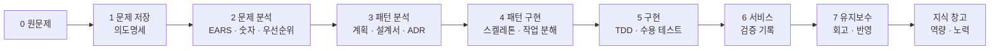
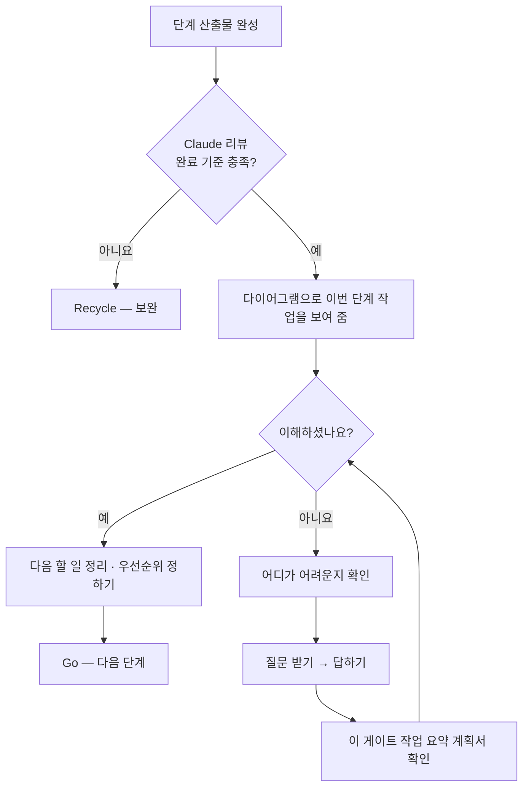

<!-- claude-drafted: 2026-10-12 — 이재엽의 답변(대화 2026-10-12)을 Claude가 요구사항으로 옮겼다. "말씀" 칸은 이재엽의 말이고, 문장·번호·"[해석]"은 Claude의 것이다. 이재엽이 확인하면 확정이다. -->

# Project Navigator — 요구사항 (V2)

> 이 문서가 V2 요구의 원천이다. 다른 문서(`final-project-plan.md` 등)와 어긋나면 이 문서를 기준으로 고친다.

## 0. 목적

> **제품 성격 (이재엽 확정 2026-10-12):** Navigator는 사용자의 프로그램을 직접 만들지 않는다. **안내하고, 사용자가 쓰는 AI 코딩 도구로 넘겨 준다.** 따라서 이 프로세스는 *바이브 코딩을 하는 사람을 위한 워크 프로세스*다. "Navigator"는 제품 이름이고, 프로세스 이름을 "바이브 코딩 프로세스"로 부를지는 이재엽이 정한다 **[해석]**.

> 사용자가 만들고 싶은 프로그램의 작업 내용을 UI에 넣으면, Claude가 우리 워크 프로세스로 작동해 **지금 몇 단계이고, 어디까지 해야 하며, 다음에 무엇을 해야 하는지** 알려 준다. 그 과정의 기록은 지식 창고에 남아 사용자의 **역량과 노력**을 보여 준다.

- **대상:** AI로 **바이브 코딩**을 하는 사람 (이재엽 확정). 학생·기획자·직장인·창작자는 *그중의 사례*이고, 대상이 코딩 밖으로 넓어지지 않는다.
- **일의 단위:** 프로그램 개발. (이전 초안의 "작업(과제·보고서…)"은 취소한다.)
- **소유·라이선스:** 대회 후 개인 작업은 이재엽이 이어 간다. 팀원 동의·대회 규정 확인 전까지 **미정** — 8절.

## 1. 워크 프로세스 — 코딩마라톤 루틴을 7단계에 합친다 (이재엽 확정)

두 루틴을 따로 두지 않고 **하나의 워크 프로세스**로 만든다. 단계의 뜻은 V1 7단계(V1 워크스페이스 `docs/00-overview/gates.md`의 DoR/DoD — 아직 이 레포로 옮기지 않았다)를 따르고, 코딩마라톤 산출물은 *그 단계 안에 들어간다.* 아래 표는 Claude의 제안 — 이재엽이 확정한다.

| 단계 | 받는 것 | 하는 일 | 나가는 것 (제안) | 코딩마라톤에서 합치는 것 |
|---|---|---|---|---|
| 0 원문제 | UI에 입력한 작업 내용 | 문제·원하는 결과·적용 대상 3요소를 묻는다. **규모(등급)를 정한다** — 즉시 처리 / Lite / Xpress / Full | 한 문장 정의, 등급 | — |
| 1 문제 저장 | 0단계 정의 | 필드를 되묻기로 채운다 | 저장된 문제 필드 | **의도명세 캔버스**, 4범주 질문(동기·범위·성공기준·메타) |
| 2 문제 분석 | 1단계 필드 | 요구 수집 → EARS 문장 → **숫자로 확정(Planguage)** → 우선순위(MoSCoW×Kano) → 출처 추적 | **확정 요구 목록** | **유스케이스**(요구의 출처), **EARS 명세**, 요구마다 **수용 테스트 명세**(Given-When-Then — 작성만) |
| 3 패턴 분석 | 확정 요구 | 후보 구조 도출 → 대안 비교(트레이드오프) → 결정 기록 | 설계 결정(ADR) | **계획**(기술 선택, 원칙 점검), **설계서**(프로세스·화면·구조) |
| 4 패턴 구현 | 설계 결정 | 가장 얇은 end-to-end 흐름을 연결(Walking Skeleton) + 작업 분해 | 연결된 최소 흐름, 작업 목록 | **작업 분해**(tasks) |
| 5 구현 | 스켈레톤·작업 목록 | 테스트 먼저 구현, **수용 테스트 실행** | 테스트 통과 코드 | 수용 테스트 실행 |
| 6 서비스 | 통과한 구현 | 2단계에서 정한 목표 수치를 실제로 재서 기록 | **검증 기록**(실제 값, 고친 결함, 못 한 것) | 검증 기록 |
| 7 유지보수 | 검증 기록 | 회고, 근본 원인(5 Whys) → **지식 창고·체크리스트에 반영** | 역량·노력 기록 갱신 | 회고 |

**이전 표(1~7 한 줄 나열)에서 고친 곳 세 가지**
1. **설계서의 자리.** 코딩마라톤은 설계서를 *명세보다 먼저* 만들었다. 이전 표는 4단계에 두었지만 실제 흐름은 2~3단계다 — 유스케이스는 요구의 출처라 2단계, 프로세스·화면·구조는 3단계.
2. **수용 테스트는 두 번 나온다.** 시나리오를 *쓰는 것*은 2단계(요구에서 나옴), *돌리는 것*은 5단계다.
3. **0단계와 "숫자로 확정"이 빠져 있었다.** 이전 표에는 원문제 정의가 없었고, 모호한 말을 숫자로 바꾸는 일(Planguage)을 "EARS" 한 칸에 뭉뚱그렸다.

### 게이트 한 번에 일어나는 일

게이트를 통과하려면 **완료 기준 충족(Claude 리뷰)과 이해 "예"가 모두** 있어야 한다.

## 2. 요구사항 (EARS)

상태: **확정** = 이재엽이 말한 것, **[해석]** = Claude가 읽은 것(확인 필요), **미정** = 값·결정이 아직 없음.

| ID | 요구 | 말씀 (원문 요지) | 상태 |
|---|---|---|---|
| FR-1 | 사용자가 UI에 작업 내용을 입력하면, 시스템은 통합 워크 프로세스에서 **현재 단계와 다음에 할 일**을 보여 준다 | "사용자가 작업 내용을 받으면 … 어느 단계인지 알려주는 게 중요" | 확정 |
| FR-2 | 시스템은 현재 단계에서 **어디까지 해야 하는지**(완료 기준과 충족 여부)를 보여 준다 | "프로그램 개발을 어디까지 해야 하는지" | 확정 |
| FR-3 | 단계가 설계도(명세·계획·설계서)를 요구하면, Claude가 **초안**을 만들고, 사용자가 **수정·작성**하면 Claude가 **다시 리뷰하고 안내**한다. 사람이 승인한 것만 확정으로 쓴다 | "클로드가 초안 … 사용자가 수정 … 너가 다시 리뷰" | 확정 (승인 규칙은 [해석]) |
| FR-4 | 게이트가 끝나면, 시스템은 그 게이트의 작업을 **다이어그램으로 보이며** "이 게이트가 끝나고 이렇게 작업했는데 이해하셨나요?"를 묻고 **예/아니요**를 받는다 | "설명할 수 있는가보다 다이어그램을 보이며 … 예 아니요" | 확정 |
| FR-5 | 사용자가 "아니요"라고 하면, 시스템은 **어느 부분을 모르는지 확인**하고, **질문을 받아 답하고**, 그 게이트의 작업 내용을 **요약한 계획서를 확인**할 수 있게 하며, **"예"가 나올 때까지** 이해를 돕는다 | "예가 나올 때까지 이해를 돕게" | 확정. "예" 전에는 다음 단계로 가지 않는다. 반복이 길어지면 사용자가 **Hold**를 고르고 **해제 조건(누가, 언제 다시 보나)** 을 적는다 — 이재엽 확정 2026-10-12 |
| FR-6 | 시스템은 **진행 상황, 내가 할 일, 다른 프로젝트·일정과의 충돌, Claude 토큰 사용**을 한 화면에 보여 준다 | "다른 프로젝트나 일정이 없는지 … 토큰 알림 … 한곳에서" | 확정. 시연은 **가상 숫자**(FR-10) |
| FR-7 | 사용자가 Claude에서 작업하면, 시스템은 그 작업 내용을 **알림으로 기록**하고 해당 할 일을 **끝났다고 표시**한다 | "클로드에서 작업하면 … 알람으로 작동한다면 끝났다고 보여주는게" | 확정(이재엽 2026-10-14 "맞다", 13-1) — 시연은 시뮬레이션, 실제 연동은 후속 |
| FR-8 | 프로젝트가 남으면, 시스템은 지식 창고에 기록을 쌓아 **역량이 무엇인지, 어떤 노력을 해 왔는지** 보여 준다 | "프로젝트가 남는다면 … 역량 … 어떤 노력" | 확정. **미정:** 역량·노력의 항목과 단위 |
| FR-9 | 사용자가 올린 글은 **기본이 나만 보기**이고, 팀에 보이는 것은 규칙을 거친 공유본뿐이다 | "개인적인 말이나 행동이 … 위험" | 확정 — 시험 완료([team-sharing-security](team-sharing-security.md)) |
| FR-10 | 대회 시연은 **서버·도메인 없이** 가상 데이터와 미리 만든 응답으로 실행된다 | "도메인 서버보다 테스트 환경 … 대회에서 환경을 보여줘야" | 확정 |
| FR-11 | 시스템(레포)은 **도와준 사람** 목록을 한 곳에 두고, 교수님과 대회에서 만난 사람들을 넣는다 | "교수님 그리고 대회로 나와줬던 사람들" | 확정. 이름 수집·동의는 [ACKNOWLEDGEMENTS](../ACKNOWLEDGEMENTS.md) |
| FR-12 | 게이트가 끝나면, 시스템은 **다음 할 일들을 정리**해 사용자가 **우선순위를 생각하고 정할 수 있게** 한다 | "지금 게이트가 끝나고 다음 할 일들을 정리해서 우선순위를 생각하고 정할 수 있도록" | 확정. 순서는 사용자가 정한다. 방식은 V1 2단계의 MoSCoW×Kano를 재사용하는 안을 제안 |
| FR-13 | 프로그래밍을 배우지 않은 사용자가 쓸 때, 시스템은 단계·완료 기준·선택지를 **전문 용어 없이 쉬운 말과 그림**으로 안내하고, 사용자가 모르는 말은 **그 자리에서 풀어 준다** | "비전공자들이 바이브 코딩을 위해서 우리 툴을 사용해야 한다 … 어떻게 디자인할 거고 어떻게 다가갈 건지" (2026-10-14) | **문장 확정**(이재엽 2026-10-14 "맞다", 13-1). **등급은 확인 대기** |

### 2-1. FR-13 상세 — 비전공자를 위한 디자인과 접근 **[제안, 확정 전]**

<!-- claude-drafted: 2026-10-14 — 이재엽의 요청("비전공자들이 … 어떻게 디자인할 거고 어떻게 다가갈 건지 하나를 더 추가")으로 Claude가 이미 확정된 요구(FR-1~5·8·12)와 기획안에서만 가져와 썼다. 인터뷰로 확인하기 전의 **가설**이다. -->

**풀려는 문제:** 비전공자는 AI가 만든 결과가 맞는지, 지금 어느 단계이고 다음에 무엇을 해야 하는지 판단하지 못해 개발이 멈춘다. 대상은 바이브 코딩을 하는 사람이라는 0절 확정은 그대로이고, 이 절은 그중 **프로그래밍을 배우지 않은 사람**에게 맞춘 디자인과 접근이다.

**어떻게 디자인하나 — 원칙 7개**

| # | 원칙 | 이미 확정된 요구에서의 근거 |
|---|---|---|
| 1 | **용어 대신 질문으로 시작한다.** "무엇을 만들고 싶으세요?"처럼 일상의 말로 묻는다 | FR-1. 등급을 묻는 문구는 인터뷰 뒤 결정(9절) |
| 2 | **지금 위치를 항상 한 줄로 보인다.** "지금 N단계 · 여기까지 하면 끝" | FR-1·FR-2 |
| 3 | **말보다 그림으로 보인다.** 게이트 다이어그램, 시연 화면의 캔버스 | FR-4, 13-1 캔버스 결정 |
| 4 | **선택지는 장단점과 함께 보이고, 결정은 사용자가 한다.** 무엇을 → 왜 → 결정 → 실행 | 기획안 ①, FR-3 |
| 5 | **모르면 막히지 않는다.** "아니요"이면 어디가 어려운지부터 묻는다 | FR-5 |
| 6 | **모르는 말은 그 자리에서 풀어 준다.** 용어 옆에서 한 줄로 설명한다 | FR-13 **[새]** |
| 7 | **블록으로 하나씩 이어 보인다.** (가) **7단계 진행** — 끝난 블록·지금 블록·앞으로 올 블록이 한 줄로 이어진다. (나) **한 단계 안의 할 일** — 무엇 → 왜 → 결정 → 실행이 블록으로 이어진다. (다) **게이트·이해 확인 흐름** — 다이어그램 → 예/아니요 → (아니요면) 확인·질문·요약 계획서가 블록으로 이어진다 | 이재엽 2026-10-14 "블럭의 형식으로 하나씩 이어지는걸 보여주는 디자인도 좋아보여", "가나다" **[확정: 가+나+다]** |

**어떻게 다가가나 — 4단계 (가설, 인터뷰로 검증)**

| 단계 | 하는 일 | 담당·시점 |
|---|---|---|
| ① 대상 확인 | 인터뷰 3~5명에 **프로그래밍을 배우지 않은 사람을 최소 1명** 넣어, 이 문제가 실제로 있는지 본다 | 고한결 #10·#11, 10/16~10/25 |
| ② 첫 장면 | 입력 → 단계 안내 첫 장면을 **용어 없이** 이해하는지 본다 | 임유정 #14·#15, 고한결 #12 |
| ③ 쓰던 도구 그대로 | 새 도구를 배우게 하지 않고, 사용자가 쓰는 AI 코딩 도구로 결과를 넘긴다 | 0절 제품 성격(확정) |
| ④ 사용 전후 확인 | 사용 테스트 5명 이상에 비전공자를 넣고, 사용 전후를 비교한다 | 두승현 #18·#20, 11/5 |

**미정:** "비전공자"의 기준(프로그래밍 수업을 들었는지 등), 용어 풀이의 수준, 첫 장면 이해의 합격 기준(수치). 값은 지어내지 않는다.

## 3. 바뀐 것 — 이전 초안과 달라지는 곳

| 이전 초안 | 이번 확정 | 고칠 문서 |
|---|---|---|
| 대상: AI를 다양하게 쓰는 사람, 일의 단위 "작업" | **바이브 코딩하는 사람**, 일의 단위 프로그램 개발 | `final-project-plan.md` (고침) |
| ② 이해 확인: 1~2개 질문 + 답변 카드 | **다이어그램 + 예/아니요**, 아니요면 확인·질문·요약 계획서. 답변 카드는 더 이상 필수가 아니다 | `final-project-plan.md` (고침) |
| 알람 = 마감 캘린더 | **한곳에서 보기** (진행·할 일·충돌·토큰) | 같은 문서(고침) |
| 두 루틴(코딩마라톤 / 7단계) | **하나로 합친 워크 프로세스** | 1절 |
| 설계도는 사용자가 먼저 쓰고 Claude가 리뷰(V1 규칙) | 제품에서는 **Claude 초안 → 사람 수정 → 리뷰** | V1 워크스페이스 규칙은 그대로 둔다(워크스페이스용) |

## 4. 시연 환경 — 서버 없이 보여 주기

| 요구 | 시연에서 | 실제 서비스에서 (후속) |
|---|---|---|
| FR-1·2 단계 안내 | 미리 만든 단계·완료 기준 데이터 | Claude API가 작업 내용을 읽고 판단 |
| FR-3 초안·리뷰 | 미리 만든 초안과 리뷰 응답 | Claude API |
| FR-6 한곳에서 보기 | **가상 숫자**(토큰·일정) | 사용량·캘린더 연동 — 데이터원 **미확인** |
| FR-7 Claude 작업 알림 | 버튼으로 "작업 완료" 이벤트를 흘려 알림이 뜨고 끝남 표시 | Claude 쪽 이벤트를 받는 방식 — **미확인** |

미리 만든 응답은 코딩마라톤의 "키 없이 도는 fixture 모드"와 같은 방식이다. 시연이 실제 Claude를 부르지 않는다는 점은 화면에 표시한다.

## 5. 지식 창고 — V1에서 가져오는 것과 새로 만드는 것

| 항목 | V1 | V2 |
|---|---|---|
| 할 일 문서·목록·번호 | 있음 | 가져옴(일반화) |
| 프로젝트 기록(단계·결정·게이트 결과) | 세션 파일·게이트 로그 | 프로젝트별 기록으로 정리 |
| **역량 지도** (무엇을 아는가) | 성장 로그의 "익힘/반복" 판정이 가장 가깝다 | **새로 정함** — 4단계 레벨(처음 봄→이해함→직접 씀→응용함, 기획안) |
| **노력 기록** (무엇을 해 왔는가) | 없음 | **새로 정함** — 단계 통과, 아니요→재확인 횟수 등 후보 |

## 6. 도와준 사람

- 넣을 사람: **교수님**, **대회에서 만난 사람들** (이재엽 확정).
- "대회에서 만난 사람들"은 **이재엽이 추후 채운다**(2026-10-12). 그때까지 빈 칸으로 둔다.
- 이름을 레포에 올리려면 **본인 동의**를 받는다. 동의가 없으면 이름 없이 "N명"으로 둔다 — [ACKNOWLEDGEMENTS](../ACKNOWLEDGEMENTS.md).

## 7. 비기능 — 이미 정해진 것

- 사람은 `main`에 직접 커밋, Claude는 브랜치만 ([CLAUDE.md](../../CLAUDE.md)).
- 비공개 레포, 개인 데이터·계정·서버 주소 없음.
- 수치·일정·기술 스택은 지어내지 않는다 — **미정**.

## 8. 이 프로세스가 우리 작업에서 작동하는가 — 검증

이재엽의 질문("원래 내용이 더 정확한지")에 대한 확인이다. 근거는 V1 기록과 코딩마라톤 기록이고, 판정은 이재엽이 한다.

### 8-1. 확인한 사실

| 항목 | 확인한 것 | 의미 |
|---|---|---|
| 기획안의 "프로젝트 8건으로 검증한 7단계" | V1 트래커에 세션으로 진행한 프로젝트는 **2건**(세컨드 브레인, 발표 준비 시스템). 8은 *분석한 레프런스 8개*(`참고 자료 8개에서…`)와 *코딩마라톤의 고친 결함 8건*에서 나온 숫자로 보이며, 프로젝트 8건 검증의 근거는 찾지 못했다 | 이 문장은 **사실과 다를 수 있다.** 수정안을 `final-project-plan.md`에 반영했다 |
| 7단계 완주 | 세컨드 브레인은 4→5 Go(2026-10-11)까지, 발표 준비 시스템은 6→7 **Hold**. **7단계(회고→반영)까지 끝낸 프로젝트는 아직 없다** | "검증됐다"가 아니라 "5~6단계까지 적용해 봤다" |
| 속도 | 세컨드 브레인: 2026-09-30 시작 → 1→2 Go 10-01, 2→3 10-07, 3→4 10-08, 4→5 10-11 (Full 등급) | Full은 무겁다 — 등급 판단(0단계)이 빠지면 바이브 코더가 첫 게이트에서 멈출 수 있다 |
| 리뷰와 자기 판정이 어긋남 | 2→3에서 자기 판정 Go, 리뷰 판정 Recycle(보안 요구 근거) | 게이트가 실제로 빠진 곳을 잡았다 — 게이트 방식은 작동한다 |
| 코딩마라톤 | 명세 554줄, 계획 137줄, 작업 535줄(체크 142개). 검증 기록에 "고친 결함"과 "하지 못한 것"이 있다 | 산출물은 AI가 만들기 좋은 모양이다. 단 게이트·회고·등급은 없다 |

### 8-2. 비교 — 어느 쪽이 정확한가

| | V1 7단계 (원래) | 코딩마라톤 루틴 (원래) | 합친 것 (이 문서) |
|---|---|---|---|
| 강점 | 단계마다 완료 기준, 등급(규모별 축소), 회고→반영 | AI가 실행하기 좋은 산출물(명세·작업·수용 테스트), 검증 기록 | 둘의 강점을 모음 |
| 약점 | 문서가 무겁고 사람이 쓰는 전제 | 게이트·등급·회고가 없다 | **더 무겁다.** 등급과 위임 규칙이 없으면 바이브 코더에게 과하다 |
| 바이브 코딩 적합 | 단독으로는 무거움 | 구현 쪽은 맞고 사람의 이해·결정 자리가 없다 | **적합 조건:** 등급 + 사람의 결정은 1~3단계와 6단계에 모으고 4~5는 AI 도구에 위임 |

**결론(Claude의 판단):** 틀(단계·게이트·등급·회고)은 **V1이 더 정확하다.** 코딩마라톤은 틀이 아니라 **각 단계 안에 들어갈 산출물**로 합치는 것이 맞고, 합친 것이 그렇게 되어 있다. 다만 *합친 상태로 돌려 본 적은 없다* — 아래 8-3으로 확인한다.

### 8-3. 지금 우리 작업을 이 프로세스에 넣어 보면

| 단계 | 이 레포에 있는 것 | 완료 기준 충족? |
|---|---|---|
| 0 원문제 | PDF 기획안, 목적 한 문장 | 충족 |
| 1 문제 저장 | `final-project-plan.md`, 요구 12개 | 충족(등급 판단은 아직 안 함) |
| 2 문제 분석 | EARS 요구 12개, 유스케이스 없음 | **미충족** — 숫자 확정 없음, 우선순위 없음, 출처 추적표 없음 |
| 3~7 | 없음 | — |

**읽는 법:** 우리 작업은 지금 **2단계 중간**이다. 이 프로세스는 이 상태에서 "다음 할 일은 ① 요구의 우선순위(MoSCoW×Kano) ② 모호한 값을 숫자나 미정으로 ③ 출처 추적표 ④ 인터뷰로 근거 채우기"라고 구체적으로 말해 준다. 이것이 FR-1·2가 하려는 일이므로, 최소한 *우리 작업을 안내하는 데는 작동한다.*

### 8-4. 작동한다고 보는 기준 (제안 — 수치는 미정)

| 기준 | 어떻게 보나 |
|---|---|
| Claude가 단계 산출물을 보고 완료 기준 충족 여부를 판정할 수 있다 | 게이트 로그에 판정이 남는다 |
| 사용자가 게이트 뒤 "다음 할 일"을 자기 말로 말할 수 있다 | 이해 확인 "예"의 근거 |
| 사용자가 한 번 돌고 막힌 곳을 말할 수 있다 | 막힌 곳 목록이 남는다 |
| 같은 프로세스를 우리 작업과 다른 작은 프로젝트(Lite) 하나에 돌려 본다 | 등급이 실제로 도움이 되는지 |

숫자(소요 일수, Recycle 횟수)는 **미정** — 한 번 돌려 본 뒤에 정한다.

## 9. 아직 정하지 않은 것

| 칸 | 누가 | 언제 |
|---|---|---|
| ~~FR-7 "Claude 작업 알림"의 [해석]이 맞는가~~ | 이재엽 | **확정(2026-10-14, 13-1)** |
| 프로세스 이름: "Navigator의 바이브 코딩 프로세스" 등 | 이재엽 | 이 문서 확인 때 |
| 등급을 바이브 코더에게 어떻게 묻는가(질문 문구) | 고한결(인터뷰 뒤) | 인터뷰 뒤 |
| 사람의 결정 자리(1~3, 6단계)와 AI 위임 자리(4~5단계)의 경계 | 이재엽 | 3단계 설계 전 |
| 7단계 "반영": 이번 프로젝트의 지식 창고만인가, 워크 프로세스 자체(체크리스트)까지인가 | 이재엽 | 7단계 설계 전 |
| 역량·노력 기록의 항목과 단위 | 이재엽 + 고한결(인터뷰 뒤) | 인터뷰 뒤 |
| 라이선스·대회 후 소유 | 이재엽 + **팀원 동의** + 대회 규정 | **지금부터 합의** — 법적 판단은 Claude가 하지 않는다 |
| 토큰 사용량·Claude 작업 이벤트의 데이터원 | 이재엽·임유정 | 실제 연동을 시작할 때 |
| 도와준 사람 명단 | 이재엽 (추후) | 이재엽이 채울 때 |

## 10. 우선순위 (MoSCoW × Kano) — 초안

<!-- claude-drafted: 2026-10-13 — 이재엽의 요청("너가 원하는 걸로 시작")으로 Claude가 요구 12개에 우선순위를 붙였다. **이재엽이 확인하기 전에는 확정이 아니다.** 근거는 이재엽의 발언, 대회 평가 기준([schedule.md](schedule.md) 1절), 11/1 기능 동결이다. -->

기준: **11/1(일) 기능 동결까지 시연 시나리오 하나가 처음부터 끝까지 도는가.** 평가는 기획 30·기술 20·협업 30·발표 10·실용 10이고, 시연은 구동 GIF·영상으로 대신한다.

| ID | MoSCoW | Kano | 판단 근거 |
|---|---|---|---|
| FR-1 단계·다음 할 일 | **Must** | Basic | 없으면 제품이 성립하지 않는다. 잘 만들어도 "당연한 것" — 최소로 만든다 |
| FR-2 어디까지(완료 기준) | **Must** | Performance | "어느 단계이고 어디까지 해야 하는가"가 이재엽이 말한 핵심이다. 완료 기준의 질이 곧 제품의 가치다 |
| FR-3 설계도 초안→수정→리뷰 | **Must** | Performance | **"AI API를 그대로 쓴 수준을 넘어"(기획 20점)를 보여 줄 가장 큰 자리**다. 잘 만들수록 점수가 오른다 |
| FR-4 게이트 이해 확인(다이어그램+예/아니요) | **Must** | Performance | 이 제품의 차별점이다("성장하는 건 사람"). 기획안 ②와 평가의 사용자 플로우 논리를 한 번에 보여 준다 |
| FR-5 "아니요" → 확인·질문·요약 계획서 | **Must** *(1회 루프)* / Could *(Hold)* | Performance | 시연은 아니요 → 질문 → 요약 계획서 → 예, **한 번의 루프**면 충분하다. "예까지 반복"과 Hold 탈출은 구조만 두고 시연에서 뺀다 |
| FR-6 한곳에서 보기 | **Must** | Excitement | **Must로 확정(이재엽 2026-10-14, 13-1).** 이유: "보기 편해서". 데이터원은 미확인이므로 시연은 가상 숫자로 한다 |
| FR-7 Claude 작업 → 알림·끝남 표시 | Could | Excitement | 해석은 확정(13-1). 후속 연동이 불확실하다. 버튼 하나로 시뮬레이션만 |
| FR-8 지식 창고(역량·노력) | **Must** | Performance | **Must로 확정(이재엽 2026-10-14, 13-1).** 이유: 시연에서는 텍스트로 적힌 부분만 보이므로 실제로 어디에 저장했는지 확인하는 시각 자료이자 표현 방식이다. 항목·단위는 미정이다. 시연에는 역량 지도 한 화면(가상 데이터) |
| FR-9 기본 나만 보기 | **Must** | Basic | 이미 구현·시험 완료(비용 0). 협업·보안 영역과 이재엽의 가장 큰 우려에 닿는다 |
| FR-10 서버·도메인 없이 시연 | **Must** | Basic | 대회가 시연을 GIF·영상으로 대신하는 구조 자체다. 선택이 아니라 전제다 |
| FR-11 도와준 사람 | Could | — | 제품 기능이 아니라 레포 문서다. 이름은 이재엽이 추후 채운다 |
| FR-12 게이트 후 다음 할 일·우선순위 | Should | Performance | V1의 MoSCoW×Kano를 재사용한다. 게이트 화면에 목록 하나를 더하는 비용 |
| FR-13 비전공자 디자인·접근 | **미정 — 이재엽이 정한다** | — | 이재엽 2026-10-14 요청으로 추가한 **[제안]**. 등급은 아직 정하지 않았다 |

**요약**
- **Must 9개**(FR-1·2·3·4·5·6·8·9·10)는 모두 *시연 시나리오 하나*로 묶인다: 입력 → 단계 안내 → 설계도 초안·수정·리뷰 → 게이트 이해 확인(아니요 1회 → 예) → 한곳에서 보기(FR-6) · 역량 지도(FR-8). FR-9는 이미 있고 FR-10은 구조 결정이라, **새로 만들 큰 것은 FR-1~5와 FR-6·FR-8의 화면**이다.
- **Should 1개**(FR-12)는 가상 데이터로 화면 하나.
- **Could 2개**(FR-7·11)는 시간이 남을 때만.

**투자 규칙 (V1 방법)**
- Must + Basic(FR-1·9·10): 최소 기능만, 더 투자하지 않는다.
- Must/Should + Performance(FR-2·3·4·5·8·12): **여기에 시간을 쓴다.**
- Could + Excitement(FR-7): 여유가 있을 때만.

## 11. 숫자 확정 점검 — 모호한 말과 빠진 값

값을 지어내지 않는다. 아래는 **정해야 할 값**이고, "후보"는 근거가 있는 것만 적었다.

| ID | 모호한 말·빠진 값 | 후보 (근거) | 정할 사람 | 언제 |
|---|---|---|---|---|
| FR-1 | "다음에 할 일" 표시 개수 | 미정 — 인터뷰에서 사용자가 몇 개까지 읽는지 본다 | 고한결 | 인터뷰 뒤 |
| FR-2 | 단계마다 완료 기준 항목 수와 충족 판정 | 판정 기준은 V1 DoD(게이트 규정)를 쓴다 — 항목 수는 미정 | 이재엽 | 3단계(10/25) |
| FR-3 | 초안→수정→리뷰의 반복 상한 | 미정 | 이재엽 | 3단계 |
| FR-4 | 게이트마다 다이어그램 종류 | 미정 — 다이어그램 가이드의 "질문→다이어그램" 표에서 고른다 | 고한결 | 화면 설계(10/25) |
| FR-5 | "아니요" 몇 번 뒤 Hold로 가는가 | 미정 *(V1 자동화 재시도 상한이 3회였다 — 참고만)* | 이재엽 | 3단계 |
| FR-6 | 가상 숫자의 범위(토큰 한도, 일정 충돌의 정의) | 미정 — 시연용 값이라 임의로 정하되 *가상임을 화면에 표시* | 임유정 | 시연 화면(11/1) |
| FR-8 | 역량 지도의 항목·단위 | 레벨은 4단계 확정(처음 봄→이해함→직접 씀→응용함), **항목은 미정** | 이재엽 + 고한결 | 인터뷰 뒤 |
| FR-10 | 시연 GIF·영상 길이 | 미정 — 발표는 10분이고 질의응답이 10분이다 | 고한결 | 발표 설계(11/6) |
| FR-13 | "비전공자"의 기준, 용어 풀이의 수준, 첫 장면 이해의 합격 기준 | 미정 — 기획안 검증 계획이 다른 유형 최소 1명을 요구한다 | 이재엽 + 고한결 | 인터뷰 뒤 |
| 전체 | 성공 수치(완주율, 설명 성공률) | 미정 — 기획안이 개발 전 인터뷰 3~5명, 개발 후 5명 이상 테스트를 요구한다 | 두승현 + 이재엽 | 인터뷰 뒤 |
| FR-9·11 | 해당 없음 | FR-9는 시험 17개로 확정, FR-11은 문서 | — | — |

숫자로 확정된 것은 **단계 수(0~7), 역량 레벨 4단계, MoSCoW 4단계, 게이트당 이해 확인 1회**뿐이다. 나머지는 **미정**이고 담당과 시점이 적혀 있다.

## 12. 출처 추적표 (RTM)

V1 RTM 형식이다. 유스케이스는 아직 없어 "출처"는 발언·문서로 적었다. 3단계 패턴·구현 위치·테스트 열은 단계가 진행되며 채운다.

| 요구 | 출처 | 3단계 패턴 | 구현 위치 | 테스트/충족 기준 | 상태 |
|---|---|---|---|---|---|
| FR-1 | 이재엽 2026-10-12 "어느 단계인지 알려주는 게 중요" · 기획안 ① | (3단계) | (5단계) | 시연에서 입력 후 현재 단계와 다음 할 일이 보인다 | 분석 완료 |
| FR-2 | 이재엽 2026-10-12 "어디까지 해야 하는지" | (3단계) | (5단계) | 단계마다 완료 기준과 충족 여부가 보인다 | 분석 완료 · 항목 수 미정 |
| FR-3 | 이재엽 2026-10-12 "클로드가 초안, 사용자가 수정, 다시 리뷰" · 평가 기획 20점 | (3단계) | (5단계) | 초안→수정→리뷰 한 바퀴가 시연된다 | 분석 완료 |
| FR-4 | 이재엽 2026-10-12 "다이어그램을 보이며 예 아니요" · 기획안 ② | (3단계) | (5단계) | 게이트 직후 다이어그램과 예/아니요가 나온다 | 분석 완료 |
| FR-5 | 이재엽 2026-10-12 "예가 나올 때까지 이해를 돕게" | (3단계) | (5단계) | 아니요 → 질문 → 요약 계획서 → 예가 한 번 시연된다 | 분석 완료 · 반복 상한 미정 |
| FR-6 | 이재엽 2026-10-12 "한곳에서 … 토큰 알림" | (3단계) | (5단계) | 가상 숫자 4개 항목이 한 화면에 보이고 *가상*이라 표시된다 | 분석 완료 · 데이터원 미확인 |
| FR-7 | 이재엽 2026-10-12 "클로드에서 작업하면 … 알람" · 해석 확정 2026-10-14 | (3단계) | (5단계) | 버튼으로 작업 완료 이벤트 → 알림 → 끝남 표시 | 분석 완료 |
| FR-8 | 이재엽 2026-10-12 "역량이 무엇인지 어떤 노력" · 기획안 ③ | (3단계) | (5단계) | 가상 데이터로 역량 지도 한 화면 | 분석 완료 · 항목 미정 |
| FR-9 | 이재엽 2026-10-12 "개인적인 말이나 행동 … 위험" | [team-sharing-security](team-sharing-security.md) | `implementations/share-prototype/share-rules.js` | `node --test` 17개, 시나리오 10개 통과 | **구현 완료**(시험) |
| FR-10 | 이재엽 2026-10-12 "도메인 서버보다 테스트 환경" · 평가 기술 10점(GIF·영상) | [schedule.md](schedule.md) 1절 | `implementations/share-prototype/index.html`(구조 확인) | 서버 없이 열리고 가상 데이터만 쓴다 | 구조 확인 |
| FR-11 | 이재엽 2026-10-12 "교수님 … 대회에서 만난 사람들" | — | [ACKNOWLEDGEMENTS](../ACKNOWLEDGEMENTS.md) | 이름은 본인 동의 뒤 | 틀만 있음 |
| FR-12 | 이재엽 2026-10-12 "다음 할 일 정리·우선순위" | (3단계) | (5단계) | 게이트 후 목록과 사용자 순위 지정이 시연된다 | 분석 완료 |
| FR-13 | 이재엽 2026-10-14 "비전공자들이 바이브 코딩을 위해서 우리 툴을 사용해야 한다 … 어떻게 디자인하고 어떻게 다가갈지" | (3단계) | (5단계) | 사용 테스트에서 비전공자가 첫 장면을 용어 설명 없이 이해했는지 확인 [제안] | **제안 — 확인 대기** |

**유스케이스**는 아직 쓰지 않았다. 2단계 DoD에 필요하면 위 시연 시나리오(입력 → 단계 안내 → 설계도 루프 → 게이트)를 기준으로 UC 하나부터 쓴다.

## 13. 확인 요청 — 이 초안에서 가장 다툴 만한 다섯 곳

게이트 규정상 **이재엽 님의 판단을 먼저** 적고 Claude 판단과 맞춘다. 이 초안은 Claude의 판단이므로 아래 다섯 곳을 *본인 판단으로* 한 번 보고 고쳐 주세요.

1. **FR-8(지식 창고)을 Should로 두었다.** 기획안 3기능 중 하나라 Must로 올릴지. → **확정됨: Must**(아래 13-1).
2. **FR-5를 Must(1회 루프)와 Could(Hold)로 쪼갰다.** 이 분리가 맞는지. → **확정됨: 맞다**(아래 13-1).
3. **FR-6을 Should로 두었다.** 이재엽 님이 중요하다고 한 기능인데 데이터원이 미확인이라 내렸다. → **확정됨: Must**(아래 13-1).
4. **FR-3을 Must/Performance로 두고 "AI 적용 합리성"의 주력으로 삼았다.** 게이트 판정 규칙(FR-2·4)과 장기 기억(FR-8) 중 어디를 주력으로 보일지(S4). → **확정됨: 둘 다**(아래 13-1).
5. **Must가 7개다.** 11/1 동결 기준으로 많은지 적은지. → **확정됨**(아래 13-1).

### 13-1. 확정 기록

<!-- claude-drafted: 2026-10-14 — 이재엽의 대화 답변을 Claude가 옮겼다. 이 표의 행은 이재엽이 말한 것만 적는다. -->

| 날짜 | 무엇을 물었나 | 이재엽의 답 | 영향 |
|---|---|---|---|
| 2026-10-14 | Must 7개(FR-1·2·3·4·5·9·10)가 11/1 시연 시나리오 한 줄기에서 각각 어떤 장면으로 나오는가 | "전부 그대로" — 7개 모두 장면으로 설명할 수 있다 | 10절 Must 7개 유지. 13절 5번 확정 |
| 2026-10-14 | FR-8(역량·노력 기록)을 Should로 둘까, Must로 올릴까 | "우리 프로젝트를 시연하게 된다면 우리 택스[텍스트 **[해석]**]라고 적혀있는 부분만 보이게 될텐데 … 실질적으로 어디에 저장했는지 확인하기 위한 시각적 자료 … 표현의 방식이라고 생각해 MUST" | FR-8 Must. Must 8개(FR-1·2·3·4·5·8·9·10). 13절 1번 확정 |
| 2026-10-14 | (a) "이런 내용들은 캔버스로 보이게 해주고" — 캔버스는 시연 화면 안의 캔버스 형태인가, 문서(의도명세 캔버스)인가 | "(다) 둘 다" | 시연 화면 안의 캔버스 형태 **와** 의도명세 캔버스 문서 둘 다 만든다. 어떤 요구 문장으로 쓸지·누가 쓸지는 대기 |
| 2026-10-14 | FR-5를 Must(1회 루프)와 Could(Hold)로 나눈 것이 맞는가 | "맞다" | FR-5 분리 유지. 시연은 1회 루프, Hold는 설계에만 남김. 13절 2번 확정 |
| 2026-10-14 | 하나를 더 추가 요청 | "비전공자들이 바이브 코딩을 위해서 우리 툴을 사용해야 한다는 건데 어떻게 디자인할 거고 어떻게 다가갈 건지에 대해서 하나를 더 추가해줘" | FR-13과 2-1 절을 **[제안]**으로 추가. 문장·등급·담당은 확인 대기 |
| 2026-10-14 | 디자인 아이디어 | "아니면 블럭의 형식으로 하나씩 이어지는걸 보여주는 디자인도 좋아보여" | 2-1 원칙 7로 **[제안]** 추가. 블록이 잇는 대상(단계·할 일·게이트)은 확인 대기 |
| 2026-10-14 | 블록이 잇는 대상: (가) 7단계 진행 (나) 한 단계 안의 할 일 (다) 게이트·이해 확인 흐름 | "가와 나로 진행해줘" 뒤 "가" → 확인 질문 뒤 "가나다" | 원칙 7 확정: (가)+(나)+(다) 모두. 처음 답(가+나)은 (다)까지로 바뀌었다 |
| 2026-10-14 | FR-6(한곳에서 보기)을 Should로 둘까, Must로 올릴까 | "must 보기 편해서" | FR-6 Must. Must 9개(FR-1·2·3·4·5·6·8·9·10). 13절 3번 확정 |
| 2026-10-14 | "AI 적용 합리성"(기획 20점)의 주력은 — (가) 게이트 판정 규칙 (나) 장기 기억 (다) 둘 다 | "다 둘 다" | 주력은 게이트 판정 규칙(FR-2·4)과 장기 기억(FR-8) 둘 다. 13절 4번 확정. #7 이슈 범위에 둘 다 들어간다 |
| 2026-10-14 | FR-7(Claude 작업 → 알림·끝남 표시)의 해석이 맞는가 | "맞다" | FR-7 해석 확정. 상태 [해석] → 확정. 등급은 Could 그대로. 시연 시나리오 작성 전 조건 해소 |
| 2026-10-14 | FR-13 요구 문장이 맞는가 (프로그래밍을 배우지 않은 사용자에게 전문 용어 없이 쉬운 말과 그림으로 안내하고 모르는 말은 그 자리에서 풀어 준다) | "맞다" | FR-13 문장 확정. 등급(Must/Should/Could)은 확인 대기 |
| 2026-10-14 | (b) "유즈케이스나 이런 부분들도 빠지면 안된다" — 어디에 둘지 | "가나다" — (가) requirements.md 새 절 + (나) `docs/04-pattern-implementation/uc/` 유스케이스별 파일 + (다) 시연 화면에서도 유스케이스 다이어그램 | 세 곳 모두에 둔다. **[제안, 확정 전]** 같은 내용이 두 문서에 있으므로 목록·개요의 원천은 requirements.md, uc/ 파일은 그 UC 번호를 가리킨다. 담당과 기한은 대기 |
