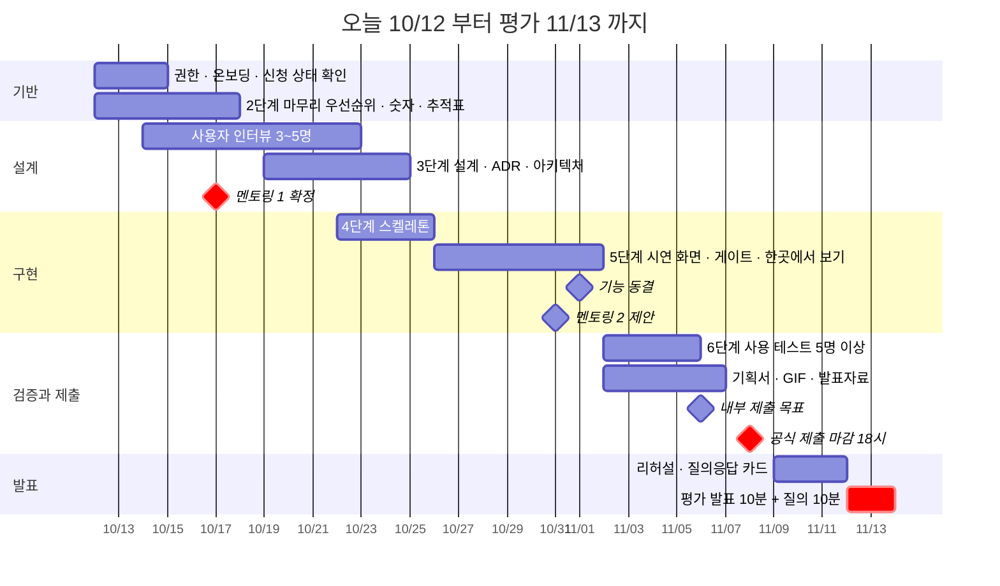

<!-- claude-drafted: 2026-10-12 — 이재엽의 요청("일정표를 이번 대회에 맞도록 조율하고 팀 역할 수정")으로 Claude가 [붙임1] 설명회 PDF의 일정·평가 기준을 읽고 썼다. 날짜와 담당은 제안이다 — 각자 확인한 뒤 확정한다. 출처 쪽수는 PDF 기준. -->

# 일정과 역할 — 코디세이 Final-Project에 맞춘 조율

출처: [붙임1] AI 네이티브 Final-Project 설명회 PDF — 추진일정(7쪽), 팀 구성(8~10쪽), 산출물(11쪽), 평가배점(12~15쪽), 평가절차(16쪽).

## 1. 대회가 정한 것 (바꿀 수 없는 것)

| 항목 | 내용 | 쪽 |
|---|---|---|
| 프로젝트 수행 | 9월 5주 ~ 11월 1주 | 7 |
| **제출 마감** | **11월 8일(일) 18:00까지**, 플랫폼으로, **팀장만** 제출 가능, 제출 후 수정 불가 | 7·15 |
| **평가** | **11월 12일(목)·13일(금)** 양일, 코디세이 교육장(변동 가능). **발표 10분 + 질의응답 10분** | 7·16 |
| 우수자 선정 | 11월 3주 | 7 |
| 통과 기준 | 평가점수 **60점 이상**만 통과. 60점 미만이면 피드백 후 재제출 | 15 |
| 지각 제출 | 우수자 선정에서 제외 | 15 |
| 발표 참석 | **최소 1명 필수 참석** — 미참석 시 FAIL | 15 |
| 팀 | 4~6인(우리 4명), 전담 멘토 매칭, **2주 1회 정기 진도 점검**(멘토 주도) | 8 |
| 팀 승인 절차 | 팀원 모집 → 멘토에게 상세기획서 제출 → 멘토 승인 → 운영진 승인(팀원 수·연락망·역할 분담) | 9·10 |

오늘(10/12, 월)부터 제출까지 **27일**, 평가까지 31일이다.

### 평가 배점 — 무엇에서 점수를 얻는가

| 영역 | 배점 | 세부 | 우리에게 뜻하는 것 |
|---|---|---|---|
| 기획 및 창의성 | **30** | 자기 주도적 문제 정의 10, **AI 기술 적용의 합리성·논리적 기획력 20** | "기존 AI API를 그대로 쓴 수준을 넘어" 문제 해결에 맞게 결합했는지 본다 |
| 기술 완성도 | 20 | 모델·알고리즘·코드 구현 10, **결과물의 구조적 완성도·실행 가능성 10** | 서면 데이터 파이프라인·시스템 아키텍처 다이어그램, UI/UX 캡처, **프로토타입 구동 GIF·영상** |
| 실용 가능성 | 10 | 실제 적용 가능 수준, 향후 BM 발전 가능성 | |
| **팀 구성 및 협업 체계** | **30** | 역할 분담의 명확성·**균형 있는 기여** 20, **Git 커밋 로그·Issue·코드 리뷰 기록 등 협업 증빙** 10 | 증빙은 *서면으로 보여야* 한다 |
| 발표 및 전달력 | 10 | 논리적 전달, 질의응답 태도 | |

기획 30 + 협업 30이 합계의 60%다. 기술 완성도는 20이다.

## 2. 일정 — 오늘부터 평가까지

| 기간 | 단계 | 해야 할 것 | 끝 조건 |
|---|---|---|---|
| **10/12 ~ 10/18** | 기반 · 2단계 | 팀원 쓰기 권한과 첫 세션 온보딩, 요구 12개의 우선순위·숫자 확정·출처 추적표, 인터뷰 질문 설계, **10/17(토) 멘토링 1** — 준비는 아래 2-1 | 2→3 게이트 Go 또는 멘토 피드백 |
| **10/19 ~ 10/25** | 3단계 · 4단계 시작 | 인터뷰 완료(3~5명), 멘토 피드백 반영, 구조 결정(ADR)과 아키텍처 다이어그램 | 3→4 Go, 인터뷰 요약 |
| **10/26 ~ 11/1** | 4~5단계 | 시연 화면 + 게이트 이해 확인 + 한곳에서 보기, 세컨드 브레인 통합, **11/1(일) 기능 동결**, **10/31(토) 멘토링 2(제안)** | 시연 시나리오가 처음부터 끝까지 돈다 |
| **11/2 ~ 11/7** | 6단계 · 제출 준비 | 사용 테스트 5명 이상, 기획서·GIF·발표자료, 11/6(금) 내부 제출 목표 | 제출 가능한 상태 |
| **11/8(일)** | **제출** | **이재엽(팀장)이** 18:00 전에 제출 | 제출 완료 |
| **11/9 ~ 11/11** | 발표 준비 | 리허설, 예상 질문 카드(`qa-prep` 스킬) | 10분 안에 끝나고 질의응답 카드가 있다 |
| **11/12 ~ 11/13** | 평가 | 발표 10분 + 질의응답 10분 | |
| 평가 후 | 7단계 | 회고, 지식 창고 반영, 대회 후 개인 작업 이전 | |

### 2-1. 10/17(토) 멘토링 1 준비

**5일 남았다.** 멘토링은 점검이므로, 가져갈 것과 물을 것을 정해 둔다.

| 가져갈 것 | 어디 |
|---|---|
| 한 문장 목적과 제품 성격 | [README](../../README.md) 1~2절 |
| 요구사항 12개와 7단계 워크 프로세스 | [requirements.md](requirements.md) |
| 일정과 역할(이 문서) | 2·3절 |
| 시연 방식 — 서버 없이 가상 데이터, 구동 GIF | README 4절, 공유 시험 화면 |
| 우리 작업의 위치 | 2단계 중간 — 우선순위·숫자·추적표를 17일까지 초안으로 |

| 멘토에게 물을 것 | 왜 |
|---|---|
| **AI 적용 범위** — Claude API를 쓰되 판정 규칙·게이트·장기 기억을 만든 것이 "그대로 쓴 수준을 넘어"로 인정되는가 | 기획 20점, S4 |
| **시연 대신 GIF·영상**으로 충분한가, 실제 호출 한 경로가 필요한가 | 기술 10점, S5 |
| **협업 증빙**으로 직접 푸시(PR 없음)가 인정되는가 | 협업 10점, S3 |
| 대회 후 결과물의 **소유·사용 범위** 규정이 있는가 | 이재엽의 대회 후 개인 작업, 라이선스 합의 |
| 평가일(11/12·13) 확정과 팀별 발표 순서 | 일정 |

- **기능 동결(11/1)과 내부 제출(11/6)** 은 우리가 정한 여유이고, 공식 마감은 11/8 18:00이다. 제출 후에는 수정할 수 없고 제출은 팀장(이재엽)만 할 수 있다. 팀장 한 명에게 걸려 있는 일이라 11/6 내부 제출 목표를 둔다.
- **멘토링 1은 10/17(토)로 예약됐다**(확정). **2회차 10/31(토)는 2주 간격 가정**이다 — 멘토와 확인 전까지 제안. 방식은 팀장이 예약해 교육장을 방문하거나 온라인(Zoom)이다(8쪽).
- **평가가 11/12인지 11/13인지**는 팀별로 아직 모른다.

## 3. 역할 — 평가 기준에 맞춰 고친 것

### 3-1. 왜 고치나

| 평가 기준 | 지금 상태 | 위험 |
|---|---|---|
| 역할 분담이 **균형** 있어야 한다(20점) | 이재엽이 총괄 + 제출 + AI 에이전트 + API 연동 + 세컨드 브레인 코드를 맡는다 | 개발이 한 사람에게 편중되어 보인다 — 아래 3-2의 완화책 |
| 협업 증빙(Git 로그·Issue·코드 리뷰, 10점) | 세 팀원이 레포에 **읽기 권한뿐**이라 커밋할 수 없다 | 커밋 로그에 한 사람만 남는다 |
| 발표(10점) + 최소 1명 필수 참석 | 발표자·질의응답 담당이 정해지지 않았다 | 미참석 시 FAIL |
| 제출은 팀장만 가능 | 팀장(이재엽) 한 명에게 걸린 일이다 | 마감 당일 위험 → 11/6 내부 제출 목표 |
| AI 기술을 그대로 쓰지 않았는가(20점) | AI 에이전트 영역의 범위가 문서에 없다 | 기획 30점 중 20점에 영향 |

### 3-2. 제안 역할 (각자 확인 필요)

| 이름 | 역할 | 맡는 것 | 평가 영역 |
|---|---|---|---|
| 이재엽 (팀장) | **총괄 · 제출 · AI 에이전트 제작 · API 연동** | 방향·일정·멘토링, **11/8 제출**, 워크 프로세스 판정 규칙·프롬프트·장기 기억, 에이전트 API | 기획, 기술(AI·API), 협업 |
| 고한결 | **UI/UX · 인터뷰 · 발표 흐름** | 화면 설계, 인터뷰 설계·기록, 발표 스토리와 자료 디자인, 사용자 테스트 진행 | 기획(문제 정의), 실용성, 발표 |
| 임유정 | **프론트엔드** | 시연 화면, **구동 GIF 제작**, API를 호출하는 화면 쪽 연결 | 기술(결과물 실행), 협업 |
| 두승현 | **테스트 · 검증 · 문서 · 협업 증빙** | 수용 테스트, 사용 전후 검증, 기획서 취합·편집, 이슈·리뷰 기록 정리 | 기술(안정성), 협업(증빙), 실용성 |

- **API 연동은 이재엽이 맡는다**(이재엽 확정 2026-10-12). 임유정은 프론트엔드에 집중한다.
- **이재엽의 담당이 많다.** 균형 기준(20점)을 위해 다른 팀원의 기여가 문서와 커밋에 *보이게* 해야 한다 — 제안: ① API 계약(요청·응답 형식)을 이재엽이 쓰고 임유정이 화면에서 검토·사용, 두승현이 계약 테스트를 쓴다 ② 인터뷰·화면·검증의 산출물은 각자의 이름으로 커밋한다.
- **발표는 이재엽 + 고한결 둘이 나눈다**(기술·구조 / 문제·사용자). 질의응답은 질문 유형별로 담당을 나눈다: 기술→이재엽·임유정, 사용자·UX→고한결, 검증→두승현.
- **협업 증빙 담당**을 두승현에게 둔 것은 일을 몰아 주려는 뜻이 아니라 *증빙이 빠지지 않게* 한 사람이 챙기자는 뜻이다. 증빙 자체는 모두의 커밋과 리뷰에서 나온다.

### 3-2-1. 역할별 작업 계획 — 누가 무엇을 언제까지 (제안, 각자 확인)

계획서만으로는 점수가 나지 않는다. 평가가 보는 것은 **산출물과 그 흔적**이다. 그래서 아래 표의 **한 줄 = 이슈 1개 = 담당자 1명 = 마감 1개**로 만들고, 산출물은 담당자 본인 계정으로 커밋한다.

| 담당 | 산출물 (위치) | 마감 | 리뷰어 | 평가 영역 |
|---|---|---|---|---|
| 이재엽 | 요구 우선순위·숫자 확정·출처 추적표 (`docs/02-problem-analysis/` 또는 `docs/00-overview/requirements.md`) | 10/16 | 두승현 | 기획 |
| 이재엽 | 구조 결정(ADR)·시스템 아키텍처·데이터 파이프라인 다이어그램 (`docs/03-pattern-analysis/adr/`) | 10/25 | 임유정 | 기술 10 |
| 이재엽 | 에이전트 판정 규칙·프롬프트·장기 기억, **API 계약**(요청·응답 형식) | 10/25 | 두승현 | 기획 20, 기술 |
| 이재엽 | API 구현·연동 | 11/1 | 임유정 | 기술 |
| 이재엽 | **공식 제출** (플랫폼, 팀장만) | 11/6 내부 · 11/8 18:00 | — | — |
| 고한결 | 인터뷰 질문지·대상 유형 (`docs/interviews/`) | **10/16** (멘토링 전) | 이재엽 | 기획(문제 정의) |
| 고한결 | 인터뷰 3~5명 요약(`응답자 A…`) | 10/25 | 두승현 | 기획, 실용성 |
| 고한결 | 화면 흐름·와이어 (`docs/04-pattern-implementation/`) | 10/25 | 임유정 | 기술(UI/UX) |
| 고한결 | 사용자 테스트 진행, 발표 스토리·자료 디자인 | 11/5 · 11/6 | 이재엽 | 실용성, 발표 |
| 임유정 | 화면 구조 초안 — 인터뷰 전이라 가설 (`frontend/`) | 10/22 | 고한결 | 기술 |
| 임유정 | 시연 화면: 단계 안내·게이트 이해 확인·한곳에서 보기 | 11/1 | 고한결 | 기술 10(실행) |
| 임유정 | **구동 GIF·영상** (제출용) | 11/4 | 두승현 | 기술 10 |
| 두승현 | 수용 테스트 틀(Given-When-Then) (`tests/`) | 10/22 | 이재엽 | 기술(안정성) |
| 두승현 | 검증 계획(사용 전후 비교 항목, 수치는 인터뷰 뒤) (`docs/06-service/`) | 10/25 | 고한결 | 실용성 |
| 두승현 | API 계약 테스트 | 11/1 | 이재엽 | 기술 |
| 두승현 | 사용 전후 검증 결과, 기획서 취합·편집, 협업 증빙 정리 | 11/5 · 11/6 | 이재엽 | 협업, 실용성 |

**규칙 네 가지**
1. 산출물은 **이슈로 올리고 담당자를 지정**한다. 이슈 없이 일하면 증빙이 남지 않는다.
2. 커밋은 **본인 GitHub 계정**으로 한다. Claude가 만든 초안도 커밋 작성자는 담당자 본인이다(공동 작성은 `Co-Authored-By`).
3. **리뷰어가 코멘트를 남긴다.** 한 줄이어도 좋다 — 그것이 "코드 리뷰 기록"이다.
4. 마감을 넘기면 담당자가 이슈에 이유와 새 날짜를 적는다(숨기지 않는다).

### 3-3. 협업 증빙 — 10점이 걸린 곳

설명회가 요구하는 증빙: **Git 커밋 로그, Issue 트래커, 코드 리뷰 기록, 공유 문서.**

| 증빙 | 지금 | 해야 할 것 |
|---|---|---|
| 커밋 로그 | 사람은 `main`에 직접 푸시 가능(팀 결정) | 팀원이 **쓰기 권한**을 받아 각자 커밋한다 — 첫 커밋은 권한 부여 직후 |
| Issue | 쓰지 않음 | 단계별 할 일을 이슈로 올리고 담당자를 지정한다 |
| 코드 리뷰 기록 | 직접 푸시는 리뷰 기록이 남지 않는다 | **코드 변경은 PR 또는 리뷰 코멘트를 남긴다.** 문서는 직접 푸시 허용 — *이 항목은 이재엽이 정한다* |
| 공유 문서 | `docs/` | 단계별 산출물이 한 곳에 있다 |

사람의 `main` 직접 푸시 결정은 그대로 두되, **코드 리뷰 기록이 남지 않는다**는 점은 평가에서 증빙 10점과 부딪힌다. 어디까지 PR로 할지는 결정이 필요하다 — 5절.

## 4. 대회 제출물 체크리스트 (평가 기준에서 거꾸로)

| 제출물 | 근거 | 담당 | 상태 |
|---|---|---|---|
| 기획서 — 문제 정의, 페인 포인트, 사용자 플로우 | 기획 30 | 이재엽·고한결 | 기획안 있음, 인터뷰 필요 |
| AI 기술 적용의 합리성 설명 — API를 그대로 쓰지 않은 부분 | 기획 20 | 이재엽 | **정해야 함** |
| 데이터 파이프라인 · 시스템 아키텍처 다이어그램(서면) | 기술 10 | 이재엽·임유정 | 3단계에서 만든다 |
| UI/UX 화면 캡처, 프로토타입 구동 GIF 또는 영상 링크 | 기술 10 | 임유정·고한결 | 시연 화면 필요 |
| 소스코드(가독성·모듈화·예외 처리) | 기술 10 | 이재엽·임유정 | 시험 화면·세컨드 브레인 코드 있음 |
| 협업 증빙(커밋·Issue·리뷰·공유 문서) | 협업 10 | 두승현 | 권한 부여 필요 |
| 역할 분담표와 기여 설명 | 협업 20 | 두승현 | 이 문서 3-2 |
| 발표자료, 예상 질문 카드 | 발표 10 | 고한결·이재엽 | 11/9 이후 |

## 5. 정해 주실 것

| ID | 질문 | 추천 |
|---|---|---|
| S1 | **세 팀원에게 레포 쓰기 권한과 초대를 언제 주나?** 협업 증빙이 이 일에 달렸다 | **오늘.** 첫 세션 온보딩도 같이 |
| S2 ✔ | 신청·멘토 | **정함(이재엽 2026-10-12):** 멘토 배정됨, 멘토링 1 = 10/17(토). 2회차 날짜는 멘토 확인 필요 |
| S3 | **코드 변경에 코드 리뷰 기록을 남기는가?** (직접 푸시 유지 + PR 코멘트) | 코드는 PR, 문서는 직접 푸시 |
| S4 | **AI 기술 적용**을 어떻게 "API 그대로가 아님"으로 보여 줄 것인가 — 워크 프로세스 판정 규칙, 게이트 리뷰, 장기 기억(RAG) 중 | 게이트 판정 규칙 + 장기 기억을 핵심으로 |
| S5 | 시연이 fixture(미리 만든 응답)만으로 충분한가, **실제 Claude 호출 한 경로**를 넣을 것인가 | 한 경로는 실제 호출 — 키는 환경변수, 레포에 넣지 않음 |
| S6 | 역할 변경(3-2)에 고한결·임유정·두승현이 동의하는가 | 각자 한 줄 답 |
