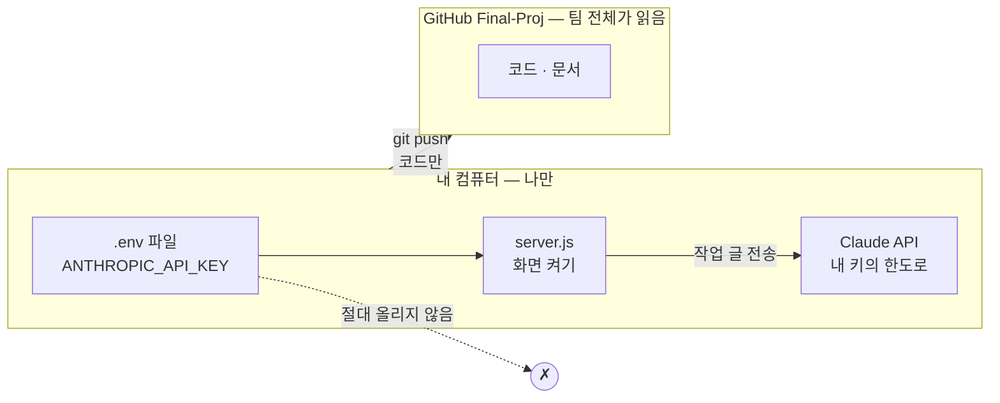
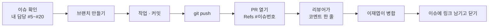

<!-- claude-drafted: 2026-10-17 — 이재엽의 요청("어디에 올리고 어떻게 해야 하는지, 사용하는 법")으로 Claude가 팀이 실제로 쓰는 방식(PR #54~#74)을 보고 썼다. 키 관련 동작은 PR #74(provider.js) 기준이다. -->

# 팀 작업 가이드 — 내 키는 어디에 두고, 작업은 어디에 올리나

한 줄: **키는 내 컴퓨터에만 두고, 올라가는 것은 코드와 문서뿐이다.**



## 1. 처음 한 번

| 할 일 | Mac | Windows |
|---|---|---|
| 받기 | `git clone https://github.com/2026-Codyssey-Final-Proj/Final-Proj.git` | 같음 (Git Bash 또는 PowerShell) |
| 폴더 들어가기 | `cd Final-Proj/implementations/navigator-prototype` | `cd Final-Proj\implementations\navigator-prototype` |
| Node 확인 | `node --version` → **v20.6 이상** | 같음 |
| 도구 받기 *(내 키로 쓸 때만)* | `npm install` | 같음 |

Claude Code를 열면 이름과 역할을 묻는다 — 대답하면 된다([CLAUDE.md](../../CLAUDE.md)).

## 2. 내 키로 시연 화면 켜기

**어느 방식으로 쓸지 고른다.**

| 방식 | 언제 | 비용·한도 |
|---|---|---|
| ① 내 API 키 | 키가 있다 | 내 키의 한도 |
| ② 내 Claude 구독 | 키는 없고 Claude Code에 로그인했다 | 내 구독 |
| ③ 연습용 예시 | 아무것도 없다 / 전송 없이 보고 싶다 | 없음 |

②·③은 키 설정이 필요 없다 — 3단계의 `server.js`만 켜면 된다.

### ① 내 API 키로 쓰기

1. **`.env` 만들기** — 이 폴더(`implementations/navigator-prototype`)에서:

   | Mac | Windows (PowerShell) | Windows (cmd) |
   |---|---|---|
   | `cp .env.example .env` | `Copy-Item .env.example .env` | `copy .env.example .env` |

2. **편집기로 `.env`를 열어** `ANTHROPIC_API_KEY=` 바로 뒤에 키를 붙여 넣고 저장한다.

   ```
   ANTHROPIC_API_KEY=sk-ant-…내 키…
   NAV_TOKEN_BUDGET=…내 한도의 80% 정도…
   ```

   - **따옴표·공백 없이** 한 줄로. `NAV_TOKEN_BUDGET`은 이 키로 쓸 한도(토큰 수) — 80%에서 알려 주고 100%에서 멈춘다. 한도가 얼마인지는 키를 만든 콘솔에서 확인한다.
   - **키를 명령어로 치지 않는다**(`echo`, `set` 등). 터미널 기록에 남는다. 꼭 편집기에서 붙여 넣는다.

3. **되는지 확인** (아주 작은 호출 1번):

   ```bash
   node --env-file=.env smoke.js
   ```

   `성공 — 이번 호출 …토큰`이 나오면 된다. 실패하면 아래 "막혔을 때".

4. **화면 켜기:**

   ```bash
   node --env-file=.env server.js
   ```

   시작 로그에 `AI: 내 API 키(…)`가 나오면 내 키로 부르는 중이다. 브라우저에서 `http://127.0.0.1:4317`을 연다.
   끄려면 터미널에서 `Ctrl + C`.

> `--env-file`이 안 되면(Node가 낡았다) 터미널에서 직접 설정해도 된다: Mac `export ANTHROPIC_API_KEY=…`, PowerShell `$env:ANTHROPIC_API_KEY="…"`. 그 터미널을 닫으면 사라진다.

### 화면에서 알아 둘 것

- 보기 방식이 **"진짜 AI"** 이면 쓴 글이 Claude로 **전송된다**. 비밀번호·다른 사람 연락처는 넣지 않는다.
- 전송 없이 보려면 보기 방식을 **연습용 예시**로 바꾼다.
- `http://127.0.0.1:4317/api/usage`에서 지금까지 쓴 토큰을 볼 수 있다(키 값은 나오지 않는다).

## 3. 작업은 어디에 올리나 — 팀이 하는 방식

**GitHub `2026-Codyssey-Final-Proj/Final-Proj`** 에 올린다. 지금 팀은 **브랜치 → PR → 이재엽이 병합**으로 하고 있다(PR #54~#74).
`main`에 직접 올려도 되지만, **PR에 남는 리뷰 코멘트가 협업 증빙(평가 10점)** 이라 PR 방식을 권한다.



```bash
git checkout main && git pull                 # 최신으로
git checkout -b docs/내-주제                  # 브랜치 — v2/…, docs/…, fix/… 중 하나로 시작
# …작업…
git add <바꾼 파일>                            # git add -A 보다 파일을 골라서 (.env가 섞이지 않게)
git commit -m "docs(범위): 무엇을 했는지"      # 제목은 `타입(범위): 설명` — docs · feat · fix · chore · refactor
git push -u origin docs/내-주제
gh pr create                                  # 또는 GitHub 웹의 "Compare & pull request"
```

**PR 본문에는** ① 무엇인가 ② 리뷰해 주실 것 ③ 확인한 것(테스트·링크)을 적고, 맨 위에 `Refs #이슈번호`를 둔다.
병합은 **이재엽**이 한다 — 내가 병합하지 않는다.

### 올리기 전에 한 번

| 확인 | 명령 |
|---|---|
| 테스트가 통과한다 | `python3 implementations/run_all_tests.py` (Windows: `python`) · `node --test` (프로토타입 폴더에서) |
| **키·비밀번호가 안 섞였다** | `git status`에 `.env`가 **없어야** 한다(무시되는 파일이라 안 보이는 게 정상). 커밋 때 `check-secrets.sh`가 한 번 더 막는다 |
| 개인 정보가 없다 | 인터뷰 응답자 이름·연락처, 다른 사람의 메시지는 올리지 않는다(`응답자 A`로) |

## 4. 하지 말 것

- ❌ **키를 채팅·이슈·PR·스크린샷·커밋에 붙이지 않는다.** 한 번 올라가면 지워도 이력에 남고, 남은 키는 폐기해야 한다.
- ❌ 남의 키를 빌려 쓰지 않는다 — 한도가 같이 줄고, 새면 책임이 불분명하다.
- ❌ `git push --force`, `main`에 Claude가 올리게 하기(훅이 막는다).
- ❌ `.env`를 `git add -f`로 억지로 올리기.

**키가 실수로 올라갔다면:** 바로 콘솔에서 그 키를 **폐기하고 새로 만든다.** GitHub에서 지우는 것만으로는 소용없다. 그리고 이재엽에게 알린다.

## 5. 막혔을 때

| 보이는 것 | 뜻 | 해결 |
|---|---|---|
| `API 키가 맞지 않거나 권한이 없어요` | 키가 틀리거나 잘렸다 | `.env`의 키를 다시 붙여 넣는다 — 따옴표·공백·줄바꿈 없이 |
| `API 호출 도구가 없어요 … npm install` | SDK를 안 받았다 | 이 폴더에서 `npm install` |
| `이 키의 토큰 한도에 다다랐어요` | `NAV_TOKEN_BUDGET`에 도달했다 | 보기 방식을 연습용 예시로 바꾸거나, 한도를 올린다. 새 키·새 시작이면 `~/.navigator-usage.json`을 지운다 |
| `잠시 너무 많이 불렀어요` | 짧은 시간에 너무 많이 눌렀다 | 잠깐 기다렸다가 다시 |
| `claude 명령을 찾지 못함` | 키가 없고 Claude Code도 없다 | 키를 넣거나, 보기 방식을 연습용 예시로 |
| `node: bad option: --env-file` | Node가 20.6보다 낡았다 | Node를 올리거나 2절의 `export` / `$env:` 방법 |
| `답이 길어서 잘렸어요` | 한 번에 받는 토큰이 모자라다 | `.env`에 `NAV_MAX_TOKENS=4096` |
| 그 밖 | | 화면의 오류 문구를 이슈나 팀 채널에 붙이되, **키는 지우고** |

## 6. 더 보기

- 환경변수 전체와 동작 원리: [navigator-prototype/README.md](../../implementations/navigator-prototype/README.md)
- 일정·역할·마감: [schedule.md](schedule.md) · [TEAM.md](../../TEAM.md)
- 공유·개인정보 규칙: [team-sharing-security.md](team-sharing-security.md)
