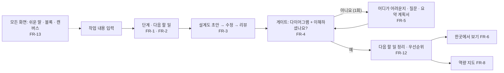
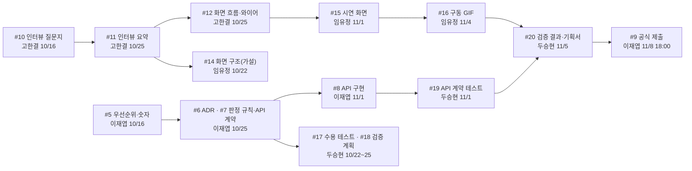

<!-- claude-drafted: 2026-10-13 — 이재엽의 요청("우선순위를 정리하고 각자의 클로드가 확인할 수 있도록")으로 Claude가 requirements.md 10~11절, schedule.md, 열린 이슈 #5~#20을 한 장으로 모았다. 원천은 그 문서들과 이슈이고, 어긋나면 그쪽이 맞다. 2026-10-14 개정 — 이재엽이 대화에서 확정한 결과(requirements.md 13-1, PR #34)에 맞춰 Claude가 고쳤다. 확정은 이재엽의 답에서만 가져왔고, 담당이 정해지지 않은 일은 "담당 대기"로 표시했다. -->

# 팀 우선순위와 이어지는 순서

> **이 문서는 길잡이다. 원천이 아니다.** 우선순위 등급과 근거는 [requirements.md](requirements.md) 10절, 숫자 점검은 11절,
> 날짜는 [schedule.md](schedule.md), 할 일은 열린 이슈(#5~#20)에 있다. 어긋나면 그쪽이 맞고, 이 문서를 고친다.
> 기준일: 2026-10-14. 등급은 [PR #34](https://github.com/2026-Codyssey-Final-Proj/Final-Proj/pull/34)(병합됨)의 확정 기록을 따른다.

**Claude에게:** 처음 세션이면 [CLAUDE.md](../../CLAUDE.md)의 "처음 세션이면"으로 이름과 역할을 확인한 뒤, 이 문서의
**"내 몫"**에서 그 사람의 줄을 읽고 "지금 무엇을 해야 하는지, 누구를 기다리는지, 누구가 나를 기다리는지"를 먼저 알려 준다.
이슈 상태와 날짜는 `gh issue list`로 한 번 확인한다(이 문서는 낡을 수 있다).

## 1. 기준 한 줄

**11/1(일) 기능 동결까지 시연 시나리오 하나가 처음부터 끝까지 도는 것.** 시연은 서버 없이 가상 데이터로 하고, 구동 GIF·영상으로 제출한다.

## 2. 우선순위 — 요구사항 13개 (이재엽 확정 2026-10-14)

| 등급 | 요구 | 한 줄 이유 |
|---|---|---|
| **Must** | FR-1 단계·다음 할 일 | 없으면 제품이 성립하지 않는다. 최소로 만든다 |
| **Must** | FR-2 어디까지(완료 기준) | 핵심 가치. 완료 기준의 질이 곧 제품의 질이다 |
| **Must** | FR-3 설계도 초안 → 수정 → 리뷰 | "AI API를 그대로 쓴 수준을 넘어"(기획 20점)를 보일 큰 자리 |
| **Must** | FR-4 게이트 이해 확인(다이어그램 + 예/아니요) | "성장하는 건 사람"이라는 차별점 |
| **Must** | FR-5 "아니요" → 확인·질문·요약 계획서 | 시연은 **1회 루프**, Hold 탈출은 Could로 나눔(확정) |
| **Must** | FR-6 한곳에서 보기 | 이재엽: "보기 편해서". 시연은 가상 숫자 |
| **Must** | FR-8 지식 창고(역량·노력) | 저장된 것을 시각으로 보이는 표현 수단(이재엽). 항목·단위는 미정 |
| **Must** | FR-9 기본 나만 보기 | 이미 구현·시험 완료(비용 0) |
| **Must** | FR-10 서버·도메인 없이 가상 데이터 시연 | 선택이 아니라 전제 |
| **Must** | FR-13 비전공자를 위한 디자인과 접근 | 이재엽: "보기 편해서". 새 요구, 새 일은 용어 즉시 풀이 |
| Should | FR-12 게이트 뒤 다음 할 일·우선순위 | 게이트 화면에 목록 하나 |
| Could | FR-7 Claude 작업 → 알림 | 해석 확정. 버튼 하나로 시뮬레이션만 |
| Could | FR-11 도와준 사람 | 제품 기능이 아니라 문서 |

**Must 10개**(초안은 7개). 새 확정은 FR-6·8·13의 등급 상승과 FR-13의 추가다. 투자 규칙: Must 중 Basic(FR-1·9·10)은 최소 기능만 만들고, Performance(FR-2·3·4·5·8)에 시간을 쓴다.

**같이 확정된 것**

| 결정 | 내용 |
|---|---|
| AI 적용 합리성의 주력 | 게이트 판정 규칙(FR-2·4) **+** 장기 기억(FR-8) 둘 다 |
| 캔버스 | 시연 화면 안의 캔버스 형태 **+** 의도명세 캔버스 문서 |
| 유스케이스 | requirements.md 새 절 + `docs/04-pattern-implementation/uc/` + 시연 화면 |
| 블록 디자인 | 7단계 진행 + 단계 안의 할 일 + 게이트 흐름을 블록으로 이어 보임 |

## 3. 어떻게 이어지는가

시연 시나리오 하나:

일의 순서(누구의 결과가 누구의 입력이 되는가):

## 4. 내 몫

### 이재엽 — 팀장 · 총괄 · AI 에이전트 · API 연동

| 이슈 | 일 | 기한 | 받는 것 | 주는 것 |
|---|---|---|---|---|
| #5 | 우선순위·숫자 확정·출처 추적표 | 10/16 | — | **PR #34 병합됨** — 두승현의 리뷰 코멘트가 남으면 닫는다 |
| #6 | 구조 결정(ADR)·아키텍처·파이프라인 다이어그램 | 10/25 | 고한결의 인터뷰 요약(#11) | 두승현의 검증 계획, 임유정의 화면 구조 |
| #7 | 판정 규칙·프롬프트·장기 기억·API 계약 — **주력은 판정 규칙 + 장기 기억 둘 다** | 10/25 | #5 | 두승현의 수용 테스트(#17), API 구현(#8) |
| #8 | API 구현·연동 | 11/1 | #7 | 임유정의 화면 연결, 두승현의 계약 테스트(#19) |
| #9 | 공식 제출 | 11/6 내부 · 11/8 18:00 | #20 | — (팀장만 제출, 제출 후 수정 불가) |

결정 대기: ① 새 일(캔버스 문서·유스케이스)의 담당·기한(아래 4-1) ② #7 이슈 설명에 장기 기억 포함 ③ 라이선스·대회 후 소유(팀원 동의 필요).
**주의:** 구조·판정 규칙·API·제출이 모두 한 사람에게 걸려 있다. 두승현의 수용 테스트(#17)를 일찍 받으면 작업을 나눠 확인할 수 있다.

### 고한결 — UI/UX · 인터뷰 · 발표 흐름

| 이슈 | 일 | 기한 | 받는 것 | 주는 것 |
|---|---|---|---|---|
| #10 | 인터뷰 질문지·대상 유형 — **프로그래밍을 배우지 않은 사람 최소 1명 포함(FR-13)** | **10/16(멘토링 10/17 전)** | 기획안 "검증 계획" | #11 |
| #11 | 인터뷰 3~5명 요약 | 10/25 | #10 | 이재엽의 ADR(#6), 임유정의 화면 구조(#14), 역량·노력 항목(FR-8), "비전공자" 기준(FR-13) |
| #12 | 화면 흐름·와이어 | 10/25 | #11 | 임유정의 시연 화면(#15) |
| #13 | 사용자 테스트 진행·발표 스토리·자료 디자인 | 11/5 | #15 | 발표 |

**역할 동의:** 완료 (2026-10-15, [PR #54](https://github.com/2026-Codyssey-Final-Proj/Final-Proj/pull/54)).
**주의:** 인터뷰가 늦어지면 임유정의 #14와 이재엽의 #6이 가설 상태로 남는다. 응답자의 이름·연락처는 레포에 올리지 않는다.

### 임유정 — 프론트엔드

| 이슈 | 일 | 기한 | 받는 것 | 주는 것 |
|---|---|---|---|---|
| #14 | 화면 구조 초안(인터뷰 전이라 가설) | 10/22 | 요구사항, 기획안 | 고한결의 와이어(#12)와 맞춘다 |
| #15 | 시연 화면: 단계 안내·게이트 이해 확인·한곳에서 보기 — **FR-8 역량 지도·블록·캔버스·UC 다이어그램이 들어갈 후보(4-1, 확정 전)** | 11/1 | #12, 이재엽의 API 계약(#7) | #16, 두승현의 수용 테스트 |
| #16 | 구동 GIF·영상 | 11/4 | #15 | 기획서(#20), 발표 |

**주의:** 서버 규칙(판정·권한)을 화면에서 다시 만들지 않는다. 시연은 미리 만든 응답으로 움직이고, 가상 데이터임을 화면에 표시한다(FR-10).

### 두승현 — 테스트 · 검증 · 문서 · 협업 증빙

| 이슈 | 일 | 기한 | 받는 것 | 주는 것 |
|---|---|---|---|---|
| #17 | 수용 테스트 틀(Given-When-Then) — **Must 10개가 대상** | 10/22 | requirements.md의 EARS 요구 | 이재엽·임유정이 만들 때의 기준 |
| #18 | 검증 계획 — **사용 테스트 5명 이상에 비전공자 포함(FR-13)** | 10/25 | #6, 11절 숫자 점검 | #19, #20 |
| #19 | API 계약 테스트 | 11/1 | #7, #8 | #20 |
| #20 | 사용 전후 검증 결과·기획서 취합·협업 증빙 정리 | 11/5 | #16, #19, 인터뷰 요약 | 이재엽의 제출(#9) |

**주의:** 확인하지 않은 것을 "확인함"으로 쓰지 않는다. 협업 증빙(커밋 로그·이슈·리뷰 기록)은 평가 30점 중 10점이다.

### 4-1. 담당이 정해지지 않은 새 일 (이재엽이 정한다)

2026-10-14 확정으로 생긴 일이다. 후보는 일정 문서의 역할(schedule.md 3절)에서 가져온 **제안**이고 확정이 아니다.

| 일 | 근거 | 후보 담당 | 상태 |
|---|---|---|---|
| 의도명세 캔버스 문서 (`docs/00-overview/canvas.md`) | 캔버스 둘 다 | 이재엽 | **담당·기한 대기** |
| 유스케이스 새 절 + `uc/` 파일 | 유스케이스 가+나+다 | 이재엽 (리뷰 두승현) | **담당·기한 대기** |
| 시연 화면: 블록·캔버스 형태·UC 다이어그램 | 블록 디자인, 캔버스, 유스케이스(다) | 임유정 #15, 고한결 #12 | **담당 대기** — #15에 화면이 늘어남 |
| FR-8 역량 지도 화면 | Must 상승 | 임유정 #15 | 어느 이슈에 넣을지 대기 |
| FR-13 용어 즉시 풀이 | 새 요구 | 임유정 #15 (문구는 고한결) | 담당 대기 |
| #7 이슈 설명에 장기 기억 반영 | 주력 둘 다 | 이재엽 | 대기 |

## 5. 날짜

| 날짜 | 일 |
|---|---|
| 10/16(목) | 인터뷰 질문지(#10), 우선순위·숫자(#5) |
| **10/17(토)** | **멘토링 1** (확정) |
| 10/22(목) | 화면 구조 초안(#14), 수용 테스트 틀(#17) |
| 10/25(일) | 인터뷰 요약(#11), 화면 흐름(#12), ADR(#6), 판정 규칙·API 계약(#7), 검증 계획(#18) — 3→4 게이트 |
| 10/31(토) | 멘토링 2 (2주 간격 가정, 멘토 확인 전) |
| **11/1(일)** | **기능 동결** — API(#8), 시연 화면(#15), 계약 테스트(#19) |
| 11/4~5 | 구동 GIF(#16), 사용자 테스트(#13), 검증 결과·기획서(#20) |
| 11/6(금) | 내부 제출 목표 |
| **11/8(일) 18:00** | **공식 제출** (팀장만) |
| 11/12~13 | 평가 — 발표 10분 + 질의응답 10분 (날짜는 팀별로 미정) |

## 6. 이 문서를 고칠 때

- 우선순위 등급을 바꾸면 **requirements.md 10절을 먼저** 고치고, 여기는 그 뒤에 맞춘다. 확정의 근거는 requirements.md 13-1의 확정 기록이다.
- 이슈 기한이 바뀌면 이슈가 맞다. 이 문서 5절과 4절의 기한 칸을 고친다.
- 담당자별 "내 몫"의 이슈가 닫히면 표에서 지우지 말고 `완료 (날짜)`로 바꾼다 — 협업 증빙이다.
