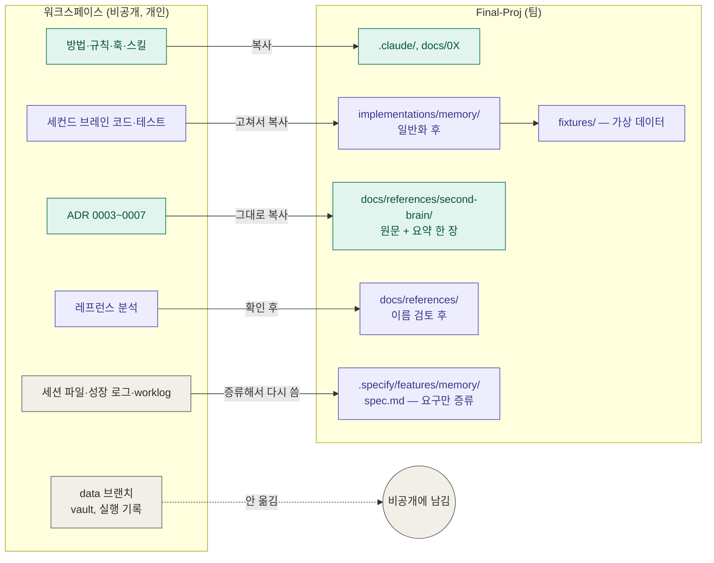
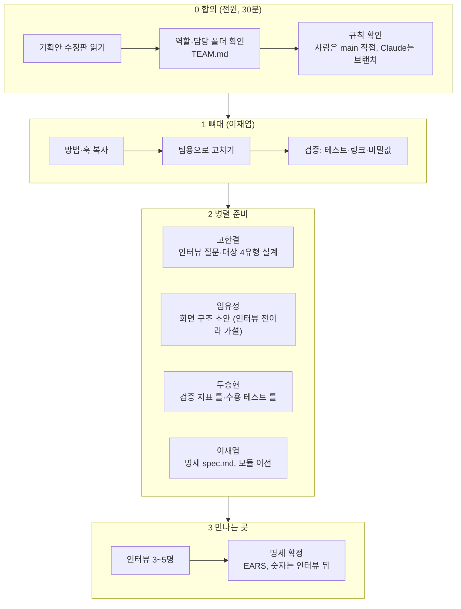

<!-- claude-drafted: 2026-10-12 — 이재엽의 요청("다 같이 준비할 수 있도록 작업 계획, 내 작업을 넣어도 데이터가 깔끔한지, 어떻게 저장할지")으로 Claude가 워크스페이스를 점검하고 썼다. 점검은 패턴 검색이고 의미 검토가 아니다 — 아래 "점검의 한계"를 본다. 날짜·수치는 정하지 않았다(미정). -->

# 팀 작업 계획과 이재엽 작업의 이전 점검

[이전 계획](migration-plan.md)을 팀이 함께 쓸 수 있게 정리한 것이다. 1절은 이재엽의 기존 작업을 이 레포에 넣어도 되는지 본 결과,
2절은 그 작업을 어디에 어떻게 저장할지, 3절은 팀이 함께 준비하는 순서다.

## 1. 이재엽의 작업 — 이 레포에 넣어도 깨끗한가

점검 대상: 워크스페이스 `main`에서 추적되는 파일 중 이전 후보(`.claude`, `docs`, `implementations`, 세컨드 브레인 코드·문서). 메일 주소, 전화번호, IP, 토큰·키 모양을 검색했다.

| 점검 | 결과 | 판정 |
|---|---|---|
| 비밀값·IP·메일·전화 패턴 | 이전 후보에서 **0건**. 걸린 4건은 글꼴 라이선스 파일의 제3자 저작권자 메일(canvas-design) | 깨끗함 |
| 개인 데이터(할 일 문서, 실행 기록) | `main`에는 없다. `data` 브랜치에만 있고 `main`은 추적하지 않는다(0개) | 깨끗함 — 분리돼 있음 |
| 이력 | 370 커밋에 개인 기록이 섞여 있다 | **이력은 가져오지 않는다.** 파일만 복사한다 |
| 세션 파일(`2026-09-30-second-brain.md`, 1037줄) | 개인 결정·계정 사실·학교 과목 언급이 53곳 | **옮기지 않는다** |
| 코드 `intake.py`·테스트 | 목적 5개(`생활·학교·작업·대회·기타`)와 번호 범위가 **코드에 고정**, 테스트 값이 실제 과목명(자료구조, 클라우드 컴퓨팅) | 옮기기 전에 **고쳐야 함** |
| ADR 0003~0007 | `Accepted`라 본문을 고치지 않는 규칙. 개인 언급은 줄 단위로 적음 | 원문 그대로 "기록"으로 두거나 요약본만 둔다 |
| 레프런스 분석 15개 (`docs/references/`) | 다른 사람의 저장소·팀 작업을 분석한 문서 | **미확인** — 사람 이름·팀원 언급을 읽고 확인한 뒤에 옮긴다 |
| 코딩마라톤 사본 63개 | 다른 팀원의 작업이 섞인 사본 | 옮기지 않는다 |
| 보안 기준 `security-records.md` | 계정 보안 상태 같은 개인 사실 | 옮기지 않는다. 팀용으로 새로 쓴다 |

**결론:** *파일 단위로는 거의 깨끗하다.* 다만 **그대로 올릴 수 있는 것은 방법·규칙·훅·스킬뿐**이고, 코드와 테스트는 일반화(학교 고정 제거, 가상 값으로 교체)가 선행이다. 세션 파일과 이력은 가져가지 않는다.

**점검의 한계 (솔직하게):** 패턴 검색이라 *이름·상황·맥락*으로 개인을 알아볼 수 있는 문장은 잡지 못한다. 옮기기 전에 이재엽이 한 번 읽어 확인한다. 특히 레프런스 분석 15개는 아직 읽지 않았다.

## 2. 내 작업을 어떻게 저장하나

한 줄 원칙: **방법과 코드는 `main`에, 개인 데이터는 레포 밖에.**

| 작업물 | 이 레포의 자리 | 방법 | 누가 |
|---|---|---|---|
| 방법론·규칙·훅·스킬 | `.claude/`, `docs/00~07` | 복사. 한 사람 기준 문장은 팀 기준으로 고침([이전 계획](migration-plan.md) 3절) | 이재엽 |
| 세컨드 브레인 코드 | `implementations/memory/` | **일반화 후** 복사: 목적 5개를 설정값으로, 테스트 값을 가상 값(`과제 A`, `프로젝트 B`)으로. 테스트를 먼저 통과시킨다 | 이재엽(코드는 Claude가 짜고 검수 — 워크스페이스 결정 유지) |
| 설계 결정(ADR) | `docs/references/second-brain/adr/` | 원문 그대로 + 한 장 요약. "이 팀의 결정이 아니라 출처"라고 머리에 표시 | 이재엽 |
| 요구사항·결정의 핵심 | `.specify/features/memory/spec.md` | 세션 파일을 옮기지 않고 **이 팀의 기획(③ 성장 기록)에 맞춰 EARS로 다시 쓴다** | 이재엽 작성, 리뷰는 두승현 |
| 레프런스 분석 | `docs/references/<이름>.md` | 이름·팀원 언급 확인 후 복사 | 이재엽 확인 |
| 개인 데이터(할 일 문서, 실행 기록, 캘린더 연결) | **레포 밖** | `data` 브랜치와 워크스페이스에 남긴다. 제품에서는 사용자별 저장소에 저장하도록 설계하고, 레포에는 가상 `fixtures/`만 둔다 | — |
| 이력(커밋 기록) | — | 가져오지 않는다. 필요하면 "출처: 워크스페이스 커밋 `<해시>`" 한 줄만 | — |

**기능 이름에서 학교를 걷어내는 방법 (제안):** 목적(`생활·학교·작업·대회·기타`)은 코드 상수가 아니라 *사용자가 정하는 분류*로 둔다. 번호 범위(1000개 단위)는 그대로 쓸 수 있다. 기본 분류는 팀이 정한다 — 기획의 사용자 4유형(학습자·기획자·학생·직장인)에 맞게. 결정 후보로만 적는다.

## 3. 팀이 함께 준비하는 순서

| 단계 | 누가 | 산출물(자리) | 끝 조건 |
|---|---|---|---|
| 0 합의 | 전원 | 읽음 확인 | 4명이 `.claude/identity.local.md`를 만들었다(각자 첫 세션) |
| 1 뼈대 | 이재엽 | 이전 계획의 1~3단계 | 훅 시험·링크 검사 통과 |
| 2-a 인터뷰 설계 | 고한결 | `docs/interviews/guide.md` — 질문과 대상 유형, 응답자는 `응답자 A`로만 | 기대 답을 암시하지 않는 질문인지 두승현이 검토 |
| 2-b 화면 가설 | 임유정 | 화면 흐름 초안(`docs/04-pattern-implementation/`) | "길 안내 / 이해 확인 / 성장 기록" 3화면이 있다 |
| 2-c 검증 틀 | 두승현 | `docs/verification/plan.md` — 사용 전후 비교 항목(수치 미정) | 비교 항목마다 측정 방법이 있다 |
| 2-d 명세 | 이재엽 | `.specify/features/memory/spec.md` | 요구마다 근거(출처)가 있다 |
| 3 확정 | 전원 | 인터뷰 결과 요약, 명세 확정 | 모호한 말이 숫자 또는 **미정**(담당·기한 표시)이다 |

**팀 규칙 두 줄**
- 사람은 `main`에 바로 올리고, Claude는 브랜치에만 올린다([CLAUDE.md](../../CLAUDE.md)).
- 수치는 지어내지 않는다. 모르면 **미정**이라고 쓰고 누가 언제 정할지 적는다.

## 4. 아직 정하지 않은 것

| 칸 | 누가 | 필요한 때 |
|---|---|---|
| 기본 분류(목적) 목록 | 이재엽 + 고한결(인터뷰 뒤) | 모듈 이전 전 |
| 인터뷰 대상 인원·유형별 수 | 고한결 | 2-a 전 |
| 일정(마감일, 중간 점검) | 이재엽 | 코디세이 일정 확인 후 — 지금은 모른다 |
| 기술 스택·배포 | 이재엽·임유정 | 명세 확정 뒤 |
| 레프런스 15개의 이름 검토 | 이재엽 | 이전 3단계 전 |
