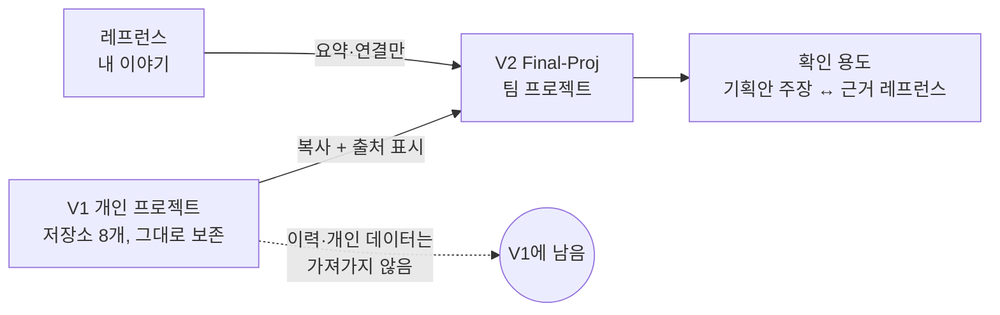
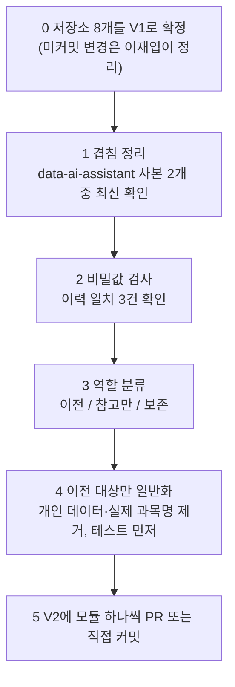

<!-- claude-drafted: 2026-10-12 — 이재엽의 요청("내 레프런스는 내 이야기이고 확인용, 코딩마라톤·스크린샷 처리, 코드 정리가 먼저, 지금까지는 그대로 두고 V2로")으로 Claude가 ~/proj 아래 저장소 8개와 레프런스 폴더를 점검하고 썼다. 코드 내용은 README·폴더 이름과 비밀값 검색만 봤고 읽지 않았다 — 표의 "미확인"을 본다. -->

# V2 — 레프런스와 코드를 어떻게 정리하나

## 0. V1과 V2

| | V1 | V2 |
|---|---|---|
| 무엇 | 이재엽의 **개인 프로젝트** (워크스페이스, 세컨드 브레인, qa-prep 등) | **팀 프로젝트** Project Navigator — 개인 프로젝트가 승격된 것 |
| 어디 | `gamercross/my-workspace` 외 개인 저장소들, 지금까지의 커밋·푸시 | 이 레포(`Final-Proj`) |
| 다루는 법 | **그대로 둔다.** 이력·PR·브랜치를 고치거나 지우지 않는다 | 새로 시작한다. V1에서 필요한 것은 *복사*해 오고, 출처를 적는다 |

- 이 레포의 `origin/main`에는 지금 `Initial commit` 하나뿐이다 — V1의 어떤 것도 아직 올라오지 않았다. V2는 깨끗한 상태에서 시작한다.
- V1 시점을 표시하고 싶으면 워크스페이스에 태그(예: `v1-personal`)를 하나 다는 것을 제안한다. **태그는 이재엽이 직접 한다**(푸시가 필요해 Claude가 하지 않는다).
- V2에서 V1을 인용할 때는 "출처: V1, `my-workspace` 커밋 `<해시>`" 한 줄이면 된다.

## 1. 레프런스 — "내 이야기"를 확인 용도로 쓴다

레프런스는 이 팀이 **왜 이렇게 기획했는지**의 근거다. 발표에서 "이건 어디서 나왔나요?"에 답하는 재료가 된다. 그래서 *원문을 쌓지 않고*, **무엇을 배워 어디에 썼는지**를 적는다.

### 1-1. 지금 있는 것

| 묶음 | 무엇 | 크기 | 지금 어디 | git에 있나 |
|---|---|---|---|---|
| 코딩마라톤 가이드 | 단계별 스크린샷·PDF·pptx 원본 (8단계 + 가이드) | 119개, 158MB | `~/proj/coding_marathon_result/코딩마라톤 가이드/` | 원본 제외, 정리 README(.md)만 `docs/coding-marathon-guide` 브랜치 |
| 코딩마라톤 결과물 | Intent-Specify 팀 과제 (명세·설계·코드 170개) | 저장소 1개 | `gamercross/coding_marathon_result` | 있음 (팀 3인 작업) |
| 내가 만든 레프런스 분석 | 다른 저장소·자료를 분석한 문서 15개 | md 15개 | 워크스페이스 `projects/second-brain/docs/references/` | 있음 (비공개) |
| 짧은 자료 | 릴스 캡처 3개 + 요약 | 520KB | `~/proj/references/짧은자료/` | 별도 |

### 1-2. 어떻게 다루나 (제안)

| 묶음 | V2 레포에는 | 레포에 넣지 않는 것 | 이유 |
|---|---|---|---|
| 코딩마라톤 스크린샷·PDF 원본 | **요약 문서만**. 필요하면 단계별로 "무엇을 가져와 어디에 썼는지" 한 장씩 | 원본 이미지·PDF | 158MB, 도메인이 안 가려진 원본, 복제·재사용 금지 표시가 있는 PDF 2개 — **원칙만** 옮긴다는 기존 약속을 지킨다 |
| 코딩마라톤 결과물 | **방식 요약**(순서·규칙)과 우리 팀에 쓴 부분의 링크 | 코드·설계서 원문 복사 | 팀 3인의 공동 작업이다. 다른 두 명의 동의 없이 옮기지 않는다 — 동의를 받으면 그 부분만 옮길 수 있다 |
| 내 레프런스 분석 15개 | `docs/references/`에 한 파일씩, **이름 검토 후** | 분석 대상 저장소의 원문 | 내 이야기라 가치가 크다. 다만 다른 사람의 이름·팀원 언급을 먼저 확인한다 |
| 짧은 자료 | 요약 한 줄 + 원 출처 링크 | 캡처 이미지 | SNS 콘텐츠라 이용 조건이 불분명하다 |

원본 스크린샷이 팀원에게도 필요하면 **레포가 아니라 팀 공유 폴더**(드라이브 등)에 두고 레포에는 위치만 적는다. 어디에 둘지는 팀이 정한다.

### 1-3. 확인 용도로 쓰는 법 — 기획안 주장 ↔ 근거

기획안의 주장마다 근거 레프런스를 한 열로 붙인다. 근거가 없으면 **공백**으로 두고, 공백이 곧 인터뷰·조사로 채울 일이다.

| 기획안의 주장 | 근거 후보 (제안 — 이재엽이 확인) | 상태 |
|---|---|---|
| ① 길 안내: 무엇 → 왜 → 결정 → 실행 | 7단계 워크플로우(V1), 코딩마라톤의 질문으로 되묻는 방식 | 확인 필요 |
| ② 이해 확인: 1~2개 질문, 답변 카드 | qa-prep-system(발표 Q&A 준비, PREP 답변 카드)(V1) | 확인 필요 |
| ③ 성장 기록: 4단계 레벨, 역량 지도 | 세컨드 브레인, 성장 로그(V1) | 확인 필요 |
| 사용자가 "AI로 만들고도 설명 못 한다" | **공백** — 이재엽 개인 경험 외 근거 없음 | 인터뷰로 채움 |
| 대상이 코딩 학습자 밖으로 넓다 | **공백** — 인터뷰 가설 | 인터뷰로 채움 |

이 표는 `docs/references/README.md`(레프런스 장부) 한 곳에만 상태를 적고, 다른 문서는 장부 ID로 가리킨다.

## 2. 코드 — 전체를 먼저 정리한다

레프런스보다 코드를 먼저 정리한다. 코드가 어디에 몇 개 흩어져 있는지부터 본다.

### 2-1. 지금 있는 것

| 저장소 | 코드 | 마지막 커밋 | 비밀값 검사 | V2에서의 후보 역할 | 비고 |
|---|---|---|---|---|---|
| `my-workspace` (V1 본체) | Python 4(620줄), JS 20 | 2026-10-06 | 깨끗함 | **방법·훅·세컨드 브레인 모듈 이전** | 일반화 선행([team-workplan](team-workplan.md)). 미커밋 29개 변경이 있다 |
| `qa-prep-system` | Python 1 + 문서 53 | 2026-09-27 | 깨끗함 | ② 이해 확인의 원형 | 스킬 중심 — 코드는 거의 없다(미확인) |
| `data-ai-assistant` / `data-ai-assistant-1` | Python 13, JS 4 | 2026-09-18 / 09-19 | 깨끗함 | 백엔드·프론트 구조 참고 | **같은 원격을 가리키는 사본 2개**(커밋 2개 vs 4개). 어느 것이 최신인지 확인 필요. "인증 없이 배포됨"이라는 교훈이 보안 기준에 있다 |
| `my-setup-proj` | Python 7, JS 8 | 2026-09-02 | 이력 1건 일치 — **확인 필요** | 에이전트·백엔드 구조 참고 | 커밋 1개, 미커밋 변경 6개. "목적성을 잃어 멈춤"이 교훈 |
| `K-Travel-Assistant` | Python 6 | 2026-08-18 | 깨끗함 | 참고만 | 미커밋 변경 5개. `.save` 임시 파일이 있다 |
| `My-Prompt-Manager` | Python 1 | 2026-08-18 | 깨끗함 | 참고만 | `main.py` 하나 |
| `coding_marathon_result` | JS/TS 170, SQL 7 | 2026-10-08 | 이력 2건 일치 — **확인 필요** (2026-10-06에 비밀번호 때문에 이력을 다시 쓴 기록이 있음, 일치 원인은 미확인) | **방식만 참고** | 팀 3인 작업, 인프라 정보가 있었다 |

**읽은 범위:** 세컨드 브레인 코드는 직접 읽었다. 나머지는 폴더 이름·README·비밀값 패턴만 봤다 — 코드의 품질과 V2 적합성은 **미확인**이다.

### 2-2. 정리 순서

| 단계 | 하는 일 | 끝 조건 |
|---|---|---|
| 0 | 저장소별 미커밋 변경(`my-workspace` 29, `my-setup-proj` 6, `K-Travel-Assistant` 5)을 커밋하거나 버린다 — **이재엽이 결정** | 모든 저장소가 깨끗한 상태 |
| 1 | `data-ai-assistant`와 `-1` 중 하나를 기준으로 정한다 | 기준 사본 하나 |
| 2 | 이력 일치 3건(`my-setup-proj` 1, `coding_marathon_result` 2)이 진짜 비밀값인지 본다. 가능하면 이전 대상에서 이력을 가져오지 않는다 | 확인 결과 기록 |
| 3 | 저장소마다 이전 / 참고만 / 보존 중 하나를 정한다 | 8개 모두 분류 |
| 4~5 | 이전 대상만 일반화하고, 모듈 하나씩 테스트와 함께 올린다 | 모듈마다 테스트 통과 |

## 3. 먼저 이재엽이 정할 것

| ID | 질문 | 추천 |
|---|---|---|
| V2-1 | 저장소별 이전 / 참고만 / 보존 분류 | 표 2-1의 "후보 역할"을 시작점으로 한 장씩 확인 |
| V2-2 | 코딩마라톤 결과물을 다른 두 팀원이 옮겨도 된다고 하는가 | 동의 전에는 방식만 |
| V2-3 | 원본 스크린샷을 팀과 공유할 곳 | 레포 밖 팀 공유 폴더 |
| V2-4 | V1 시점 태그(`v1-personal`)를 달지 | 단다 — 한 줄이고 되돌릴 수 있다 |
| V2-5 | 레프런스 분석 15개의 이름 검토 | 이재엽이 읽어 표시하거나, Claude가 사람 이름·팀원 언급 후보만 뽑아 준다 |
