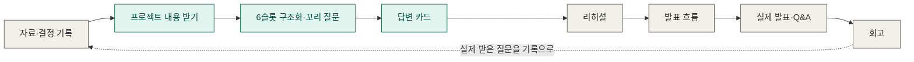
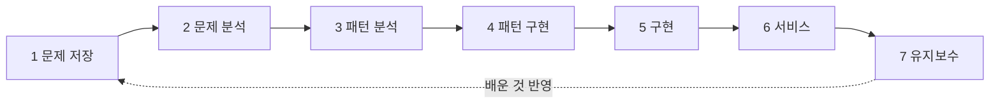

# QA 준비 시스템 (qa-prep-system)

> **출처: 이재엽의 개인 프로젝트 "Alcovibe" 워크스페이스의 `qa-prep-system` 파일.** 팀 기준이 아니라 **참고 자료**다. 팀에는 같은 이름의 스킬(`.claude/skills/qa-prep`)이 이미 있다. 발표 준비(11/9~11/11)에 쓸 수 있다.


발표에서 받을 질문에 미리 대비하도록 돕는 시스템입니다. 사람이 자기 프로젝트와 예상 질문을
미리 이해하고, 결정의 이유·대안·기준을 말로 꺼낼 수 있게 준비하는 것이 목적입니다.

> **진행 상태는 이 문서에 적지 않습니다** — 세션 파일 (개인 저장소 파일 — 이번에 가져오지 않음)의
> 게이트 로그가 원천입니다. 아래 내용 중 검증되지 않은 것은 "가설" 또는 "초안"으로 표시했습니다.

## 어떤 문제를 푸는가

면접, 팀 공유, 레퍼런스 시연 같은 자리에서 **"왜 그렇게 결정했어요?"** 라는 질문에 막히는 문제입니다.
결정의 이유는 기억나는데 말로 정리가 되지 않고, 메모로만 남기면 나중에 이유가 기억나지 않습니다.

| 대상 | 상황 |
|---|---|
| **A** | 워크플로우가 없어서 결정 이유가 정리되지 않은 사람 |
| **B** | 워크플로우와 내용은 있지만 발표하는 방법을 모르는 사람 |

## 무엇을 만들려는가

자기 내용과 예상 질문을 미리 이해하고 Q&A 답변까지 준비하는 순환입니다.



초록색이 1번 조각(검증용 도구), 회색은 나중에 만들 부분입니다.

| 조각 | 내용 | 상태 |
|---|---|---|
| **1** | 프로젝트 내용을 받아 6슬롯(상황, 목적, 이유, 전략, 요구, 기한)으로 구조화하고, 비거나 얕은 슬롯에서 꼬리 질문을 만들어 준비하는 사람이 놓친 부분을 찾고, PREP 순서의 답변 카드까지 만든다 | 1번 조각 (진행 상태는 세션 파일) |
| 2 | 리허설: 질문을 던지고 답변에 피드백 | 나중에 |
| 3 | 긴 발표 흐름 (SCQA, 스파크라인) | 나중에 |
| 4 | 기존 기록(ADR, 게이트 로그, 회고)과 연결 | 나중에 |
| 5 | 다른 곳으로 내보내기, 예상 질문 자동 생성, 데이터 가공 | 나중에 (ADR 필요) |

**1번 조각은 시스템 전체가 아니라 가설을 싸게 검증하기 위한 도구입니다.** 검증하려는 가설은 다음과 같습니다.
"답변 카드를 준비하면 Q&A 준비가 실제로 좋아진다." 이 가설은 아직 검증되지 않았습니다.

## 성공 기준

- **측정 기준(초안):** "왜 그렇게 결정했어요?"에 준비 없이 **1분 이내**, 결론 1문장 + 이유 최대 2개 + 사례 1개로 답한다. 정확한 값은 2단계 3번(정량화)에서 확정합니다.
- **기대하는 가치:** 개인 성장과 팀의 발표 역량. 두 가치를 각각 어떻게 재는지는 아직 정해지지 않았습니다.

## 알아 둘 점

- **답변 구조(PREP 등)는 공식 표준이 아닙니다.** PREP은 원 출처를 확인하지 못해 "출처 확인 불가, 실무에서 통용되는 후보 구조"로 표시합니다. Minto·SCQA, Duarte 스파크라인, Made to Stick도 검증된 표준이 아니라 후보입니다.
- **지금까지의 원자료는 한 사람의 진술입니다.** 실제로 받은 청중 질문 데이터는 아직 없습니다.
- **6슬롯은 사용자 제안이며 출처를 확인하지 않았습니다.** 청중이 실제로 묻는 영역(위험, 비용, 근거 데이터 등)을 다 덮는지도 확인되지 않았습니다. 큰 파일에서 예상 질문을 자동으로 만드는 기준은 조사하지 않았습니다.
- **조각 1이 처음 계획보다 커졌습니다.** 입력이 "질문 하나"에서 "프로젝트 내용"으로 바뀌어, 싸게 검증하려던 도구가 더 무거워졌습니다.

## 현재 진행 상태

**상태는 이 문서에 적지 않습니다.** 같은 상태를 여러 문서에 따로 적으면 서로 어긋나고, 그때마다 다시 맞추고 보고해야 하기 때문입니다. 아래 곳이 원천이고, 다른 문서는 링크만 겁니다.

| 알고 싶은 것 | 원천 |
|---|---|
| 지금 어느 단계이고 게이트를 통과했는가 | 세션 파일의 게이트 로그 (개인 저장소 파일 — 이번에 가져오지 않음) |
| PRD 섹션이 확정, 초안, 미정 중 무엇인가 | 세션 파일의 PRD (개인 저장소 파일 — 이번에 가져오지 않음), 각 섹션 제목 옆 태그 |
| 진행 중인 항목 한눈에 | [트래커](../../../01-problem-save/sessions/README.md) (게이트만 요약) |
| 무엇이 왜 바뀌었나 | PRD 변경 기록, [worklog.md](worklog.md) |
| 워크플로우를 돌려 본 결과 | [test-log.md](test-log.md) |

이 프로젝트는 아래 개발 워크플로우(7단계)를 그대로 따라 진행합니다.

## 개발 방식: 7단계 워크플로우

[my-dev-process](https://github.com/gamercross/my-dev-process)의 `template` 브랜치에서 출발했고, 지금은 [워크스페이스](../../README.md)의 한 프로젝트로 루트 워크플로우를 공유합니다.
각 단계를 통과할 때마다 게이트로 확인하고, **결정과 그 근거를 남기는 것**이 핵심입니다. 그 기록이 나중에
발표에서 "어떻게 진행했고 어떤 기준으로 결정했는지"에 답하는 재료가 됩니다.



이 프로젝트에서는 시작 이후 게이트 규칙을 보강했고, 워크스페이스로 합치면서 공통 규칙으로 승격했습니다.

- PRD 결정을 게이트 로그의 필수 칸으로 기록하고, PRD 섹션이 전부 확정되기 전에는 2단계로 넘어가지 않습니다.
- 앞 단계 결정이 바뀌면 뒤 단계 산출물을 "잠정"으로 표시하고 게이트를 다시 통과합니다.
- 이 규칙들이 실제로 작동했는지는 [test-log](test-log.md)와 세션 파일 게이트 로그에 있습니다.

자세한 규칙: [게이트 규정](../../../00-overview/gates.md), [규모 판단](../../../00-overview/scope-tiers.md),
[스킬 절차](../../../../.claude/skills/dev-workflow/SKILL.md).

## 문서 지도

| 무엇을 보고 싶은가 | 어디에 있나 |
|---|---|
| 프로젝트의 문제·PRD·명세 | 세션 파일 (개인 저장소 파일 — 이번에 가져오지 않음) |
| 저장 구조 결정 | [ADR-0002](V1-ADR-0002-piece1-storage-structure.md) |
| 결과물 스킬 | [qa-prep](../../../../.claude/skills/qa-prep/SKILL.md) (워크스페이스 루트) |
| 진행 중인 항목 한눈에 | [트래커](../../../01-problem-save/sessions/README.md) (워크스페이스 루트) |
| 단계별 방법론 | 루트 `docs/01-*` ~ `docs/07-*` |
| 패턴·체크리스트 누적 | 루트 [docs/catalog/](../../../catalog) |
| 작업 과정과 테스트 결과 | [worklog.md](worklog.md), [test-log.md](test-log.md) |
| 발표에서 받을 예상 질문 (작업 내용에서 뽑은 것) | [expected-questions.md](expected-questions.md) |

## 폴더 구조

```
projects/qa-prep-system/
  CLAUDE.md                     프로젝트 라우터
  docs/
    00-overview/                expected-questions.md, test-log.md, worklog.md(이 프로젝트 기록)
    01-problem-save/sessions/   이 프로젝트의 세션 파일
    03-pattern-analysis/adr/    ADR-0002
  implementations/project-track/  4·5단계 테스트 기록
../../.claude/skills/qa-prep/   결과물 스킬 (루트)
```
